# 瑞赢 0.1 产品需求文档（PRD）

> 客户既有基线（DEC-059／DEC-060／DEC-061）：客户主档不保存负责人；新建客户原子创建初始经营关系；全国公海收纳零条有效经营关系的客户主档；客户关系网为轻量四类关系。客户列表的范围顺序与默认值以 2026-10-12 本轮调整为准：全部／团队／我负责的／我协作的；全部仅指当前用户有权查看的经营客户，全国公海仍从单独入口进入。冲突时以最新明确确认结论为准。

> 迭代：`202609_0.1.0`　需求名称：瑞赢首个销售闭环
> 文档版本：V0.45.2（任务候选写入失败处理）　产品负责人：梁国权　更新日期：2026-10-15
> 文档状态：**联合评审稿**——范围与产品规则已完整，可进入产品、业务与技术联合评审；§13.2 的初始化配置和 §13.3 的外部能力开关不阻塞技术方案和开发，但阻塞对应能力的启用与验收
> 原型入口：`prototype/index.html`、`prototype/pc.html`；`prototype/architecture.html` 为评审辅助，旧 `manager.html`、`admin.html` 仅作历史差异证据。
> 端形态：**H5 优先服务销售个人执行，主管通过一个团队处理入口进入源业务；PC 优先服务主管团队业务，也支持个人销售。两端均可由销售和主管使用。PC 为统一应用、一个首页和四个业务一级导航分组。**两端共用对象、状态、权限和服务（见 §6、§11.1）

| 版本      | 日期         | 修订人 | 备注                                                                                                                                                                                                                                                                                                                                                                                                                     |
| ------- | ---------- | --- | ---------------------------------------------------------------------------------------------------------------------------------------------------------------------------------------------------------------------------------------------------------------------------------------------------------------------------------------------------------------------------------------------------------------------- |
| V0.45.1 | 2026-10-15 | 梁国权 | H5 增加个人速记：全局悬浮入口、默认语音、异步转写、连续录制、文本录入及本人历史；仅本人可见，不自动进入正式业务事实。细则见 00 §6.12B 与 04 §3.0。 |
| V0.45.0 | 2026-10-12 | 梁国权 | 0.1 轻量化：PC 五类业务列表默认全部可见范围；任务状态与时间不限，日报当天且状态不限；H5 团队快捷入口合并；管理分析及指标配置退出，系统管理收敛，保留必要日志与审计记录。 |
| V0.44.0 | 2026-10-10 | 梁国权 | 更新 PC 任务与业务配置评审口径；客户合并状态和历史合并数据整体退出当前需求、样例与验收。详见 00／01／03／04／06 与验收用例。 |
| V0.43.0 | 2026-10-09 | 梁国权 | 同步 PC 原型评审口径：日报主管查看三栏布局、周／月日历与周期统计；商机自定义字段配置退出 0.1，商机改用普通字段；页面说明与演示记录不作为正式业务对象。详见 00／03／04／06 与验收用例。 |
| V0.42.2 | 2026-10-09 | 梁国权 | 客户价值分级由有权人员直接设置或调整，保存即生效并逐次留日志；取消主管复核、复核状态、7 天期限和相关提醒。同步 00／01、验收、长期规则及 PC 原型。 |
| V0.42.1 | 2026-10-09 | 梁国权 | 移除 0.1 客户身份核验状态及按钮；保留信用代码查重、工商查询结果、数据质量标签与资料修改日志。同步 00／01、权限与验收、PC 原型。 |
| V0.42.0 | 2026-10-09 | 梁国权 | 客户合并及错误合并恢复退出 0.1；疑似重复仅人工核对，历史已合并客户只读保留原编号和主客户入口。同步模块 PRD、长期规则、验收和 PC 原型。 |
| V0.41.1 | 2026-10-08 | 梁国权 | 销售活动改用“实际沟通人”；与决策链角色分列。记录活动时不强制创建正式联系人，已建档可关联，未建档可先记录姓名或称谓。HTML 原型未修改。 |
| V0.41.0 | 2026-10-08 | 梁国权 | 按产品说明口径重整总 PRD：页面行为契约归 00，模板、Agent 与管理分析细则归模块；保留跨模块规则、产品数据结构与关键验收；去除技术设计回填清单和逐条测试用例覆盖门槛。HTML 原型未修改。                                                                                                                                                                                                                                                                                                                    |
| V0.40.0 | 2026-10-08 | 梁国权 | 按 DEC-063 将人工权限收敛为销售、销售主管/经理、管理员（运营）三角色；仅配置功能列表和按钮；销售可看本人、协作、池待认领线索完整信息与全国公海完整客户详情，主管增加本团队，管理员看全部；取消一期字段范围与明文限制。同步 00～08 模块、验收用例和长期资产；HTML 原型未修改。                                                                                                                                                                                                                                                                      |
| V0.38.0 | 2026-09-24 | 梁国权 | 线索新增去除独立联系人电话；业务状态改为待处理、跟进中、已转化、无效；整条转换至少创建一条商机，每条商机分别选择客户及该客户下的联系人，保持整体事务。同步模块 02／03、长期规则、原型及验收用例。                                                                                                                                                                                                                                                                                                                    |
| V0.37.0 | 2026-09-22 | 梁国权 | 组织关系调整为客户关系网；取消客户资料治理，改为权限控制＋修改历史；门店完整退出 0.1。本次同步清理正文：§4.4B／§6.19A 改为「不在 0.1 范围」、§4.4C 重写为客户关系网 CREL 轻量模型、§5.10A 改为客户关系网维护流程、新增 §6.19B，并清理术语表、状态枚举、对象前缀、ERD、字段字典、审计范围、权限矩阵、验收标准（AC-01／AC-27／AC-31／AC-38／AC-41）、§13.2／§13.4 和 §14 追溯矩阵中的旧口径。本次只同步 0.1 PRD 与 HTML 原型，测试用例及其他事实文档待后续模块定稿后统一更新。                                                                                                                            |
| V0.36.1 | 2026-09-22 | 梁国权 | 所有角色的 PC 客户列表增加「全部客户」；范围为至少一条有效经营关系的客户，全国公海仍作为单独入口。同步 0.1 PRD 与 HTML。                                                                                                                                                                                                                                                                                                                                                  |
| V0.36.0 | 2026-09-22 | 梁国权 | 客户列表只按有效经营关系计算；全国公海改为客户主档列表并移除经营单位、区域与业务线展示；组织关系维护明确四个上下级方向；删除经营关系主动释放公海，停止最后一条有效关系时系统自动入池。同步当前 0.1 客户 HTML 原型。                                                                                                                                                                                                                                                                                                        |
| V0.35.0 | 2026-09-22 | 梁国权 | 完成 06 模块 Q1～Q27 最终回写：固定 2 个分析页面、8 个业务配置页面、2 个指标配置页面和 1 个 Agent 配置页面；收口 6 主题 24 指标、任务／日报／商机／数据质量口径、PC 分析与下钻、A/B 类配置、指标版本、Agent 四页签、能力权限、固定导出模板和验收数据集。团队日报、任务验收、拜访复核归 04，AI 运行治理、企微同步、异步处理、异常和审计查询归 08；旧 HTML 保持历史差异证据，不作为目标信息架构。                                                                                                                                                                                        |
| V0.34.0 | 2026-09-21 | 梁国权 | 完成 05 Agent 模块最终决策回写：以 H5 为主操作端、PC 轻治理；建立核心阻断闭环／0.1 配套能力／正式增强输入三层；工作手机退出本期；候选四态与写入四态分离；日报采用独立版本模型；活动先写、任务后写并允许部分成功；一期使用 Coze 私有化且不得直接写 CRM；同步权限、撤权、来源治理、Run ID、系统预生成、上线准入、POC 与验收。本次不修改 HTML。                                                                                                                                                                                                                          |
| V0.33.0 | 2026-09-21 | 梁国权 | 回写 PC 两阶段最终决策：统一应用／工作区／首页与五类导航；首页固定快捷入口；取消最近访问、快捷自定义和保存视图；统一批量、导入、导出及处理记录；R5 改为固定最高权限角色；系统管理补齐人员权限、两类配置、异常质量、指标知识、集成消息、审计和失败恢复；删除临时代办、独立原件治理及通用平台化能力。本次不修改 HTML。                                                                                                                                                                                                                                                       |
| V0.1.0  | 2026-09-11 | 梁国权 | 创建；完成 §1–§8 主干                                                                                                                                                                                                                                                                                                                                                                                                         |
| V0.2.0  | 2026-09-11 | 梁国权 | 补齐 0.1 范围、页面、Agent、看板口径、集成与非功能、验收、待确认分级和追溯矩阵；修复对象、权限和状态冲突                                                                                                                                                                                                                                                                                                                                                              |
| V0.3.0  | 2026-09-11 | 梁国权 | 端形态调整为桌面端为主、移动端可用；§3.4/§3.5 列表与表单规则、§6.1–§6.25 页面描述、§11.1 入口、§11.8 兼容、§13 PRD-Q-14 同步回写                                                                                                                                                                                                                                                                                                                                |
| V0.4.0  | 2026-09-12 | 梁国权 | 建立“总体 PRD + 7 份模块详设”结构（当时为 01～07；后加入 08-PC 基础平台与集成治理，现共 8 份，见“模块详设索引”）；补充联系人独立列表/详情和客户地址对象、页面、权限、流程及验收                                                                                                                                                                                                                                                                                                                 |
| V0.5.0  | 2026-09-12 | 梁国权 | 客户公海调整为 0.1 P0 并支持多公海池配置；Agent 由三类候选扩展为 AI 销售工作记录、AI 任务推进、AI 销售总结三个能力组合。其中多公海池规则已由 V0.30.0 替代。                                                                                                                                                                                                                                                                                                                         |
| V0.6.0  | 2026-09-12 | 梁国权 | 工商信息自动查询与更新进入 0.1 P0；补充客户关系图、联系人关系与通话记录、客户/联系人地址、商机团队和详情信息架构；客户公海并入客户管理导航但不合并数据对象                                                                                                                                                                                                                                                                                                                                      |
| V0.8.0  | 2026-09-14 | 梁国权 | 对账 4 份原型并收口交付可执行性：登记主管端日报审阅、任务验收、拜访复核 3 个页面契约；清除已过期的“待原型补齐”标记并对齐配置端路由；新增 §13.2 初始化配置交付表与 §13.3 外部能力开关定性；修正 §12.5 验收编号区间                                                                                                                                                                                                                                                                                                |
| V0.9.0  | 2026-09-14 | 梁国权 | 修正文档内枚举与结构不一致（零业务规则变更）：§4.16 任务生成方式对齐 §3.2 四值并按 §4.10 补全枚举；§3.2 状态枚举总表补“销售活动类型”行；模块索引与版本历史明确模块详设为 8 份；登记 `prototype/architecture.html` 为辅助文档（非页面契约，不计入 36 个 id）；§6.25 视图容器契约改为按 hash 路由＋重新渲染，取消与原型不符的 `data-view` 一一对应和“不重写 DOM”要求；§12 AC-43～AC-45 移至 AC-42 之后，§12 编号恢复单调递增（不重编号）；01～08 各自散落的“试点前回填／待回填”清单合并进 §13.2／§13.3／§13.4 并改为指针引用；§13.2 配置项由 16 项增至 18 项                                                         |
| V0.10.0 | 2026-09-14 | 梁国权 | **统一对象术语为“销售活动”**（零业务规则变更）：正文原“活动”“互动”“销售互动”三种口径一律改称销售活动，复合词一并改全称（销售活动类型、销售活动原件、销售活动时间线、销售活动候选）；覆盖 0.1 文档集与 `assets/` 共 18 份文件。保留非对象语义的“市场活动”（线索来源枚举值）、“民事活动”（组织客户法律定义）、“晚间活动”（纪要时限例外口径）。模块 04 文件名同步改为 `04-任务销售活动日程与日报.md`。§3.1 术语表增补统一说明；**销售活动对象编码前缀由 `INT` 统一为 `ACT`**，与 §4.2 ERD 实体、§6.11 页面契约 `PG-ACT-NEW`、`assets/business-object-model.md` 三处既有口径对齐，`testcase.md` 用例编号 `INT-01`～`INT-04` 同步改为 `ACT-01`～`ACT-04` |
| V0.11.0 | 2026-09-14 | 梁国权 | 收口三项联合评审前规则：销售与主管共用统一业务工作台，菜单按角色能力与数据范围展示，右上角身份切换仅用于静态原型演示；无客户线索可直接记录销售活动，销售活动改为至少关联一个业务对象，关联商机时继承主客户；预计成交时间创建时可空，离开“机会确认”前强制补齐。同步更新模块 03、04、06、07。                                                                                                                                                                                                                                                                    |
| V0.12.0 | 2026-09-15 | 梁国权 | 收口客户经营模型：客户主档负责人可空，销售责任落在客户＋区域＋业务线；增加门店、门店业务线和门店资方合作关系；公海当时区分区域／全国池并按支持人员控制查看与认领。其中门店资方、多池和支持人员规则已分别由后续版本替代。本次只更新 PRD 与 assets，原型不变。                                                                                                                                                                                                                                                                                   |
| V0.12.1 | 2026-09-15 | 梁国权 | 原型按 V0.12.0 与 §6.25 对账补齐（零业务规则变更）：三份原型修复 `path()` 未剥离查询串导致带参数深链全部落到 fallback；统一实现 `from` 来源回跳（往返都带来源）、`preview=1` 配置端只读预览（横幅＋阻断配置写入）与 `businessLine` 按业务线查看客户公海；补齐 §6.25 17 条 P0 路径中原型缺失的起点入口；§6.0 补登 `PG-ADM-TPL` 的既有子路由 `#/template/edit`、`#/template/view`，并明确"同端同模块子路由以本表列出为准"。原型改动清单见 `prototype/CHANGELOG.md`。                                                                                                   |
| V0.13.1 | 2026-09-15 | 梁国权 | **统一对象术语为“门店”**（零业务规则变更）：原“经营网点／网点”统一改为“门店”，关系对象同步改为“客户—门店关系”“客户—门店—业务线关系”“门店资方合作关系”；覆盖 `assets/`、完整 PRD、模块详设、架构说明及原型。代码内部兼容标识 `OUTLET/outletId` 暂不改名。                                                                                                                                                                                                                                                                 |
| V0.14.0 | 2026-09-17 | 梁国权 | 以 9 月 16 日原型为 1.0 全景、9 月 17 日材料为衍生说明；0.1 增加统一日程与受限双向同步、轻量知识和消息中心；确认协作任务不复制、会议候选人工批量确认、日报不退回重提且主管独立读状态／建议、互动时间线和 Agent 核心对象写入边界。                                                                                                                                                                                                                                                                                        |
| V0.15.0 | 2026-09-18 | 梁国权 | 收口客户组织与资方版本边界：0.1 只建设集团成员和总分机构关系，总分机构同一有效期只允许一个直接总机构并允许多级链；股权、控制、商业合作和资方退出 0.1。资方仅作为后续候选业务角色保留在长期演进说明中，本次同步 PRD 与 assets，不修改 HTML、原型和测试用例。                                                                                                                                                                                                                                                                             |
| V0.16.1 | 2026-09-18 | 梁国权 | H5 增加“我的销售活动”轻量列表，支持查看本人最近记录及按客户、类型、日期简单筛选；团队查询、复杂筛选和导出仍由 PC 承担。新增具体视图 `VIEW-H5-ACT-LIST`，不新增页面契约；本次不修改 HTML 和测试用例。                                                                                                                                                                                                                                                                                                    |
| V0.18.0 | 2026-09-19 | 梁国权 | 客户数据改为分层治理：销售直接维护授权范围内的普通经营信息；主体身份、注册地址、集团成员／总分机构、门店所属客户和合并恢复等高影响变更复用数据质量治理事项，由获授权 R4 能力人员校验生效，不新增通用审批引擎。知识管理改为可组合权限，不增设固定知识管理员角色。本次不修改 HTML。                                                                                                                                                                                                                                                                          |
| V0.19.0 | 2026-09-19 | 梁国权 | 收口商机流程模板缺失兜底：无唯一生效模板时阻断正式商机创建，展示匹配键、缺失／重复原因和可复制问题信息；0.1 通过现有线下群协调销售运营修复后重试，不新增异常工单、待配置商机或自动通用模板。试点前需校验启用范围的模板覆盖。本次不修改 HTML。                                                                                                                                                                                                                                                                                            |
| V0.21.0 | 2026-09-19 | 梁国权 | 明确 0.1 不建设知识纠错反馈入口、反馈单、处理队列或状态流；销售通过现有线下群反馈运营人员，由获授知识维护权限的人员核实后在 PC 修订、发布或停用，正式知识变更继续留版本和审计。本次不修改 HTML 和测试用例。                                                                                                                                                                                                                                                                                                          |
| V0.22.0 | 2026-09-19 | 梁国权 | 收口人员准入与身份边界：瑞赢实时订阅公司用户中心消息并自动拉取符合条件的销售；企微认证沿用公司既有 ZR 工号绑定规范，瑞赢不维护第二套身份映射；自动授予基础销售角色及组织／区域／业务线范围，其他角色和跨范围权限另行授权，映射缺失时不展示业务数据。本次不修改 HTML。                                                                                                                                                                                                                                                                                |
| V0.23.0 | 2026-09-19 | 梁国权 | 将数据范围从自动重算收缩为半自动：人员准入、ZR 认证结果和基础销售功能角色自动；区域／业务线范围由获授权销售运营人员配置。调岗时系统按生效时间停止受影响旧范围、保留未变化范围并生成权限待处理事项和受影响对象清单，不自动授予新范围或移交业务责任。本次不修改 HTML。                                                                                                                                                                                                                                                                                 |
| V0.24.0 | 2026-09-19 | 梁国权 | 确认人工权限使用统一配置入口：不设置审批流，不拆分普通数据范围与高风险附加权限两套授权机制；角色、范围、字段、动作、报表、Agent 和接口仍作为独立权限项显式配置。获授权人员预览变更、填写原因后保存，配置立即生效并完整审计。本次不修改 HTML。                                                                                                                                                                                                                                                                                           |
| V0.26.0 | 2026-09-19 | 梁国权 | 确认统一权限配置能力按具名人员名单授予，默认从少量销售运营／业务配置管理员中指定；R5 系统管理员不自动获得，确需承担权限配置职责时加入同一名单。名单内人员配置全部权限维度，不拆普通范围与高风险配置人员。本次不修改 HTML。                                                                                                                                                                                                                                                                                                      |
| V0.28.0 | 2026-09-20 | 梁国权 | 完成 01 客户、联系人与地址逐项确认：删除公共占位客户、经营优先级、默认地址／门店、门店区域／责任覆盖和下游映射；确认身份核验、异常事项、轻量地址、门店 1:N、联系人共享资料、经营关系／公海、价值轻复核、双端页面、权限、批量并发、外部降级与验收闭环。本次不修改 HTML。                                                                                                                                                                                                                                                                             |
| V0.29.0 | 2026-09-20 | 梁国权 | 完成 02 线索与线索池逐项确认：采用极低门槛创建、来源与系统记录来源分离、分层查重、五态状态机、单一活跃归属、按来源池持有量、保护期不自动回收、活动／任务／计划分离、转交退回回收、整体事务转换、无效纠错、固定模板导入、双端页面、权限审计异常和客观指标；删除通用线索拆分、部分成功转换、占位客户、自动路由／回收和个人保存视图。本次不修改 HTML。                                                                                                                                                                                                                                         |
| V0.32.0 | 2026-09-20 | 梁国权 | 完成 04 模块两阶段规则收口：任务来源决定接收、流程属性决定验收；正式拜访与销售活动独立；任务仅投影截止时间且不同步企微；日报提交时冻结；工作台取消今日三件事；企微消息完全由系统白名单控制。同步更新长期资产、模块 PRD、验收和决策登记，不修改 HTML。                                                                                                                                                                                                                                                                                      |
| V0.30.0 | 2026-09-20 | 梁国权 | 客户公海收缩为唯一全国公海：公海承载原客户＋区域＋业务线经营单元的待分配经营权，不新建经营单元或改变区域；所有销售可看完整客户详情，认领仍校验动作权限、区域／业务线资格、持有上限、保护和并发；删除区域公海、多池、支持人员、跨池和两级路由及其批量、权限、页面、审计、通知和验收描述。本次不修改 HTML。                                                                                                                                                                                                                                                                |
| V0.31.0 | 2026-09-20 | 梁国权 | 完成 03 商机与流程模板逐项确认：正式商机客户必填且采用单当前客户；主业务线＋销售场景唯一匹配版本化模板；协同业务线无独立场景和流程；确认顺序推进、历史回退、轻量门槛、正式阶段任务、商机自定义字段、模板迁移、团队轻协作、停滞休眠、关闭重开、主动拆分及数量/周期/结果指标；删除产品/金额、部分赢单、竞争信息、阶段跳级/免办和复杂自动化。存量商机迁移退出当前 PRD。本次不修改 HTML。                                                                                                                                                                                                                    |

| V0.39.0 | 2026-09-24 | 梁国权 | 按 DEC-062 收口商机流程状态：仅进行中／已结束；已结束结果仅赢单／输单／关闭；停滞保留为提醒，不再有休眠；仅已结束（关闭）可重新激活。同步 03、06 模块和验收用例。 |

## 阅读指引与引用约定

**本文档不重述系统级长期事实。** 系统定位、对象模型、业务规则、状态机、权限模型、集成边界见项目 `assets/`，本文档只写 0.1 的落地方式（页面、字段、门槛、提示、参数）。

约定如下：

| 约定 | 说明 |
|---|---|
| 规则引用 | 直接写 `编号`（如 `LEAD-03`、`OPP-06`），不复制规则原文，便于 assets 变更时定点回写 |
| 决策引用 | 写 `DEC-xxx`，与 `research/2026Q3-ruiying-0to1-design_瑞赢0到1设计/decision-register.md` 一一对应 |
| 页面契约与具体视图 | 写 `PG-xxx` 表示稳定页面契约；H5／PC 的具体页面、页签、抽屉写入 `prd/00-产品结构与页面清单.md`。原型未补齐前不要求与 HTML 路由一一对应 |
| 新增待确认 | 写 `PRD-Q-xx`（本文档引入的、assets 中尚无对应 DEC 编号的问题），统一收敛到 §13 |
| 待确认项 | 不自行推断结论；与已确认规则冲突的内容不写入正文 |
| 文档完整性 | §1–§14 均为本次产品评审范围；未定业务参数列入 §13.2 初始化配置交付表与 §13.3 外部能力开关定性。页面行为细则在 00 模块，沿用原 `6.x` 编号以便查阅 |

**PRD 编写边界**：总 PRD 说明产品目标、版本范围、跨模块流程与统一规则，并保留理解业务所需的对象、关系、字段、状态和关键验收条件；模块 PRD 说明本模块页面行为、字段、权限、异常与验收重点。数据库表、索引、接口协议、事务/缓存/重试等实现方案由研发设计；完整测试用例和测试结果由测试人员维护。PRD 中的唯一性、一致性、降级与性能要求表达产品结果，不指定研发实现方式。

**范围声明**：本文档描述 `0.1`。`1.0` 目标能力全景见 `assets/system-functional-modules.md`，版本演进见 `assets/system-roadmap.md`。

### 01 模块已确认基线

客户领域详细规则以 [01-客户联系人与地址](prd/01-客户联系人与地址.md) V0.21 为准。该版本替代本文较早版本中关于客户资料治理、组织关系复杂模型和门店 0.1 能力的旧描述。本次已按该版本同步清理本文正文：**门店完整退出 0.1**，原「组织关系」统一改为「客户关系网」并采用关联客户＋四类关系＋关系标签＋备注的轻量模型，**客户资料不再走治理流程**，改为权限控制＋修改历史。当前 0.1 HTML 已同步本版客户口径。

### 02 模块已确认基线

线索领域详细规则以 [02-线索与线索池](prd/02-线索与线索池.md) V1.3 为准。该版本替代本文较早版本中关于线索拆分、疑似重复关系、部分成功转换、公共占位客户、自动路由／回收、日／周领取上限、首次联系 SLA、个人保存视图和通用外部线索 API 的旧描述。HTML 原型仍是旧视觉参考，不构成业务契约。

### 03 模块已确认基线

商机领域详细规则以 [03-商机与流程模板](prd/03-商机与流程模板.md) V1.3 为准。该版本替代本文较早版本中关于未识别客户商机、参与客户及客户角色、产品和金额、部分赢单、竞争信息、阶段跳级/免办、复杂自动动作、休眠、赢输单重开和存量商机迁移的旧描述。HTML 原型仍是旧视觉参考，不构成业务契约。

### 模块详设索引与责任边界

本文档负责 0.1 的产品目标、范围、统一术语、跨模块规则与流程、必要的数据结构、产品约束和关键验收。`prd/00-产品结构与页面清单.md` 负责功能树、端职责、页面行为契约、具体视图和覆盖状态；其余 **8 份模块 PRD（01～08）** 负责本模块动作、字段、权限、异常和验收重点。长期系统规则见 `assets/`。引用若出现冲突，按最新已确认决策核对并回写对应文档，不由原型或研发设计自行选择口径。

| 模块详设                                          | 覆盖范围                                               |
| --------------------------------------------- | -------------------------------------------------- |
| [00-产品结构与页面清单](prd/00-产品结构与页面清单.md)           | H5、主管扩展及统一 PC 应用的完整导航、页面行为契约、入口去向与覆盖状态   |
| [01-客户联系人与地址](prd/01-客户联系人与地址.md)             | 客户主档、客户关系网、联系人与关系、地址、价值分级、区域业务线经营关系、客户公海经营权 |
| [02-线索与线索池](prd/02-线索与线索池.md)                 | 线索创建、查重、入池、派领、保护、转交、退回、回收、跟进、整体事务转换与来源追溯           |
| [03-商机与流程模板](prd/03-商机与流程模板.md) | 商机创建、主/协同业务线、场景与模板、双层阶段、门槛/任务、普通字段、停滞提醒、结束及关闭后重新激活和拆分 |
| [04-任务销售活动日程与日报](prd/04-任务销售活动日程与日报.md)       | 任务、今日工作台、日程视图、拜访、外勤、销售活动和日报闭环                      |
| [05-Agent候选与人工确认](prd/05-Agent候选与人工确认.md)     | 统一 AI 入口、销售工作记录、任务推进、销售总结、候选确认和可信执行底座              |
| [06-业务配置](prd/06-管理看板与配置中心.md) | 八个业务配置子菜单及 Agent 四页签，保留 A／B 类规则与版本边界；分析和指标配置退出 0.1 |
| [07-权限通知审计与异常](prd/07-权限通知审计与异常.md)           | 三角色与数据范围、功能列表/按钮权限、通知、审计、幂等、异常和非功能要求                     |
| [08-PC业务工作台、基础平台与集成治理](prd/08-PC基础平台与集成治理.md) | 统一 PC 首页与导航、业务页面、人员权限、业务配置、异常事项、知识管理、AI 运行处理及技术日志边界 |

---

## 1. 目标与范围

### 1.1 迭代背景

瑞赢已完成 0→1 的核心产品原则、业务规则、关键状态流转和权限模型确认。公司线下使用的销售管理标准（每日沟通频次、约访数量、拜访场次、纪要时限）已经有建议基线，但缺少承载这些动作的系统。

0.1 的任务不是把 `1.0` 功能做全，而是**打通并验证最小完整闭环**，形成第一个可以交给技术排期的版本。9 月 16 日 V2.1 原型代表领导的 `1.0` 完整目标全景，9 月 17 日 Word／Excel 只是衍生说明和研发跟踪；冲突时以 9 月 16 日方向和最新明确确认结论为准（`DEC-037`）。依据 `DEC-005`，0.1 先完成系统实现，再从两个区域选择销售试点；试点参数在启动前补齐。

### 1.2 0.1 目标

在 `assets/system-roadmap.md` §4 原 11 项范围基础上，本次增补客户公海和三组 Agent 能力，0.1 要形成下面这条可用的闭环；路线图中的版本落位将在本次范围评审确认后同步：

```text
客户价值分级、客户关系网、客户—区域—业务线经营责任
→ 客户主档、联系人关系与线索进入（查重、入池）
→ 线索进入对应线索池，或客户区域业务线经营权进入唯一全国公海，被分派、主动认领、保护、释放和回收
→ 产生候选或正式任务；候选需人工确认，正式任务直接待处理并由负责人执行
→ 销售通过日程安排拜访、执行并记录销售活动／外勤结果
→ 线索转换或商机按流程模板推进
→ 瑞赢 AI 生成销售记录与任务候选，并提供线索摘要、业务问答和日报／管理反馈
→ 销售确认候选后写入正式记录；摘要与回答保留事实来源
→ 销售编辑 AI 底稿并一次提交日报，主管阅读并按需追加建议
```

目标状态是「**闭环可用**」：Agent 不可用时仍可手工完成核心流程；客户价值由有权人员直接设置并记录日志；客户主档可无经营关系，销售责任按“客户＋区域＋业务线”维护且不设经营优先级；客户关系网不扩大权限；公海只流转经营权。

端职责遵循最新决策：H5 优先服务销售个人高频执行，主管通过一个团队处理入口进入源业务；PC 优先服务主管／经理的团队处理，同时支持其本人销售工作。销售与主管均可使用 PC 和 H5。PC 通过首页及客户管理、销售管理、工作管理、系统管理四个业务一级导航承接业务与配置。两端共用服务端规则，不建立第二套销售事实。

### 1.3 本次新增与调整

`0.1` 是新建系统，全部页面与对象均为新增。相对前期讨论稿，本次按已确认决策做了以下口径调整，实施时以本节为准：

| 调整 | 与前期材料的差异 | 依据 |
|---|---|---|
| 商机阶段改用五个统一管理阶段 | `research/.../lead-opportunity-standard-flow.md` 中的 D／C／B／A／存量属于原线下客户机会阶段，不作为瑞赢商机阶段 | `DEC-003`、`DEC-026` |
| 客户不再有线上机会阶段 | 不设计客户阶段字段、状态机、推荐或变更历史 | `DEC-002`（废止）、`DEC-026` |
| 线索业务状态收敛为四态 | 讨论稿中的「未分配／已作废」不进入业务状态；是否在池、持有人、保护期与业务状态分离 | `LEAD-09`、`DEC-017` |
| 客户公海进入 0.1 | 原资产将客户公海排在后续版本；本稿将客户—区域—业务线经营单元的全国公海占用、派领、保护、释放和回收纳入 P0，客户主档不入池，经营单元不新建且原区域不改变 | 本次范围确认、`DEC-025`、`CUST-27`～`CUST-29` |
| Agent 采用分层能力模型 | 分为核心上线阻断闭环、0.1 配套能力和增强输入；对象摘要优先支持线索、客户和商机 | `DEC-057` |
| 客户及商机详情深化 | 工商自动查询/刷新进入 P0；客户关系网收敛为关联客户＋四类关系＋关系标签＋备注的轻量模型，股东／控制信息只作外部工商快照；联系人增加联系与人物关系；商机增加团队；客户公海仅在导航层并入客户管理 | 本次客户关系网口径、最新确认 |
| H5／PC 端职责重设 | H5 优先服务个人执行并保留轻量团队处理；PC 优先服务主管团队业务并支持个人销售；销售和主管均可使用两端 | 2026-10-12 本轮确认 |
| 任务统一三状态 | UI 使用自建任务、主管指派、沟通提炼、规则生成四类来源；正式任务直接待处理，负责人完成，创建人改期或取消；逾期是标识 | `DEC-051` |
| 日报一次提交与阅读 | 状态仅草稿／已提交；不退回重提；主管独立读状态并可追加建议 | `DEC-040` |
| 统一日程与企微同步 | 只有独立日程是真实日程对象；任务、正式拜访、线索／商机作日历投影；企微只同步独立日程和正式拜访 | `DEC-052` |
| 互动、知识与消息 | 拜访必须关联客户；瑞赢轻量知识和轻量消息中心进入 0.1 | `DEC-041`、`DEC-042`、`DEC-044` |
| 客户经营责任增加区域维度 | 客户主档负责人可空；销售责任改由客户＋区域＋业务线关系承载，同一经营单元一个主负责人、多个协作人 | `CUST-15`、`CUST-21` |
| 门店退出 0.1 | 门店菜单／入口、原型页面、前端页面、业务逻辑和专属交互全部删除，不以代码注释保留；后续如需恢复，从现有备份重新取回并另行确认，仅作为后续版本候选 | 本次范围确认 |
| 客户关系网取代原组织关系 | 原「组织关系」统一更名为「客户关系网」，只表达客户与其他客户的业务或组织关联；支持集团关系、总分关系、上游、下游四类，采用关联客户＋关系类型＋关系标签＋备注的轻量模型，不建设复杂关系属性 | 本次范围确认 |
| 取消客户资料治理 | 客户资料改为权限控制＋修改历史；有编辑权限直接修改并立即生效，无权限只读并联系有权限的主管或销售运营；全部修改进入客户详情「历史」，不建设修改申请、治理事项、资料审批或变更复核流程 | 本次范围确认 |
| 公海只保留全国单池 | 经营权保留原区域和业务线，不建设区域池、跨池或两级路由；所有销售可看完整客户详情，认领和管理按钮单独授权并校验区域／业务线资格 | `CUST-27`～`CUST-29` |

### 1.4 本次不做（硬边界）

以下内容**明确不在 0.1 范围**，原型中不作为可操作入口出现：

1. 竞争信息、独立竞品模块和独立投标模块；采购／投标仅作为流程模板中的可配置详细阶段（`OPP-17`）。
2. 合同、订单、履约、应收、回款、成本、报销等复杂下游集成（`DATA-04`、`system-overview.md` §3.2）。工商信息服务是客户建档 P0 能力，不属于本条排除范围。
3. 把下游业务系统的业务记录复制成新的瑞赢客户主体（`CUST-06`、`CUST-07`）。
4. AI 推断直接作为正式客户、线索、商机、销售活动、任务或日报事实（产品原则 6、`WORK-04`）。
5. 未明确授权和人工确认时的自动报价、承诺、对外发送或高风险写入（`system-overview.md` §3.2）。
6. 客户 D／C／B／A／存量作为线上字段、状态或看板维度（`CUST-16`、`DEC-026`）。
7. 复杂量化客户价值评分模型（`CUST-13`、`DEC-008`）。
8. 以采购工作手机作为启动前提（`system-overview.md` §3.2）。
9. 周报。日报进入 0.1；周报不在 0.1 范围，后续版本规划（`system-functional-modules.md` §2）。
10. 个人企微日程接入、路线规划、连续轨迹和考勤。0.1 提供统一日程和应用创建日程受限双向，不读取个人企微日程（`DEC-038`）。
11. 公司知识库完整接入、工作手机和全渠道会话自动接入；0.1 先交付瑞赢轻量知识（`DEC-041`）。
12. 个人排行榜、自动绩效评分或用定位异常直接形成绩效结论（`DEC-036`）。
13. 股权投资、控制管理、商业合作和资方的结构化关系、页面、状态、配置、权限、通知、验收与 Agent 能力。资方保留为后续候选业务角色，后续立项时重新验证，不在 0.1 建空表、隐藏菜单或通用关系引擎（`CUST-26`）。
14. 知识纠错反馈入口、反馈单、处理队列、处理状态与结果通知。0.1 使用现有线下群反馈运营人员，系统只承接核实后的知识修订、发布、停用、版本和审计（`WORK-42`）。
15. 商机产品、数量、单价、折扣、预计金额、报价、合同金额、多币种和金额分析；部分赢单和业务线混合结果。
16. 商机阶段跳级、条件免办、通用自动化规则引擎、自动阶段推进、阶段任务验收和团队角色自动任务路由。
17. 商机多客户角色、参与客户、多候选签约主体、AI 摘要和主动升级最新模板。
18. 存量商机导入规则、迁移页面和通用迁移工具；该事项转入上线准备与数据迁移专项。

### 1.5 完成判断

- 一条线索可以从进入、查重、入池、派领、跟进、转换走到商机创建与阶段推进，全过程有负责人、有留痕。
- 正式商机必须关联有效客户，并以客户、名称、唯一主业务线和销售场景作为成立条件；主业务线＋场景唯一匹配生效模板。
- 任务、销售活动、日报三者的数据不重复填报：日报由当日已确认事实生成。
- Agent 生成的销售活动和任务候选，未经确认不进入正式记录；日报使用独立版本模型；Agent 不可用时有等价手工路径。
- 客户、线索、商机、任务、日报从 PC 菜单进入时展示当前用户有权查看的全部数据；状态和时间按各模块默认规则独立筛选。
- 客户价值由有权人员直接设置／调整并逐次留历史；经营关系只维护有效／停止、主负责人和协作人（`CUST-13`、`CUST-15`、`CUST-21`）。
- 销售可以创建独立日程和正式拜访计划；普通任务按截止时间投影到统一日历，会议任务按会议开始至结束时间投影且结束时间即任务截止时间；不创建企微任务日程。
- 主管指派的正式任务直接进入待处理，负责人可查看并处理；任务不设置接收、拒绝、验收或退回流程。
- 日报从 AI 底稿编辑后一次提交且不可退回、重提或提交后编辑；主管独立维护读状态并可追加无需回复的建议，不能改写销售内容。
- 系统只建设一个全国客户公海；它收纳当前零条有效经营关系的客户主档。公海列表不展示经营单位、区域或业务线；认领／分派时才指定区域、业务线和主负责人。停止最后一条有效关系后自动入池，不提供主动释放公海。
- 系统可维护客户关系网，表达当前客户与其他客户之间的业务或组织关联；每条只维护关联客户、关系类型、关系标签和备注。股权、控制、商业合作、有效期、关系权重、多层股权穿透、自定义关系类型和复杂关系审批不进入 0.1，且页面、接口、权限和验收中均无操作能力。门店不进入 0.1。
- 瑞赢 AI 以一个 H5 入口提供沟通整理和配套能力；线索、客户、商机摘要、业务问答和主管关注摘要均追溯正式事实，不自动修改业务状态或形成绩效结论。

---

## 2. 角色与权限

### 2.1 人工角色与数据范围

0.1 只保留三个可登录的人工角色。Agent／服务身份用于系统调用，不作为人工角色或第四种业务数据范围。

| 角色      | 可查看的业务数据                                | 主要职责                            |
| ------- | --------------------------------------- | ------------------------------- |
| 销售      | 本人负责的记录、本人参与的协作记录、有成员资格的线索池待认领线索、全国公海客户 | 执行本人销售业务；认领另校验按钮权限和业务资格         |
| 销售主管/经理 | 销售本人范围及本团队成员的业务记录                       | 执行个人销售业务和获授权的团队分派、拜访复核、日报建议 |
| 管理员（运营） | 全部业务记录                                  | 执行获授权的业务配置、客户资料、知识、异常与系统治理   |

数据范围按角色及实时人员/团队关系确定，不配置区域、业务线、字段或单条记录的额外查看范围。客户主档不保存负责人：「我负责的」依据有效经营关系的主负责人，「我协作的」依据有效经营关系的协作人；创建人只是审计属性。主管/经理的团队成员以公司用户中心同步关系为准。相同客户可因不同经营关系进入本人或团队范围，但客户列表去重。全国公海客户可打开完整客户详情；线索池待认领线索可查看完整线索信息。关联的其他独立对象仍按自身数据范围鉴权。

### 2.2 权限配置与计算

0.1 只配置功能列表权限和按钮权限。功能列表权限控制菜单、页面和列表入口；按钮权限控制详情查看、创建、编辑、认领、分派、转派、合并、普通业务导出、发布、停用、重试等动作。两个配置均须在服务端校验；页面隐藏按钮不能替代鉴权。

最终操作还须满足角色数据范围、对象当前状态、池成员及接收资格、业务规则和并发版本。查看业务记录后可读取该记录全部业务字段，不设置字段范围、独立明文查看权限或按角色脱敏。密码、Token、密钥等系统凭证仍不得明文展示，应用日志不得记录敏感原文。数据范围适用于搜索、列表、详情、关联、看板、下钻、导出、消息深链和 Agent，失权后不得泄露标题、摘要、数量或无权关联。

### 2.3 三角色功能与按钮矩阵

下表是 0.1 默认配置基线；具体动作以功能列表和按钮配置为准，获得数据查看权不自动获得编辑或管理按钮。管理员（运营）查看全部数据，但操作仍按配置和业务规则执行。

| 功能/动作 | 销售 | 销售主管/经理 | 管理员（运营） |
|---|---|---|---|
| 客户、联系人、线索、商机、活动、任务、日程、日报的业务列表与详情 | 本人及协作范围；池线索和公海客户完整可见；普通联系人列表按本人负责或协作客户关联判断 | 本人及本团队；普通联系人列表增加团队客户关联 | 全部 |
| 本人业务创建、编辑、跟进、候选确认 | 按按钮与对象状态 | 按按钮与对象状态 | 按按钮与对象状态 |
| 线索池/全国公海认领 | 按按钮、成员资格和业务校验 | 按按钮、成员资格和业务校验 | 按按钮、成员资格和业务校验 |
| 团队分派、回收、任务源队列、拜访复核、日报建议 | — | 按按钮与团队范围 | 按按钮与全部数据范围 |
| 客户身份字段编辑、客户关系网 | 按配置的编辑按钮 | 按配置的编辑按钮 | 按配置的编辑按钮 |
| 流程模板、线索池、公海、任务、拜访、知识及 Agent 配置 | — | 查看已发布适用规则 | 按功能列表与编辑/发布等按钮 |
| 普通业务导出与允许的批量操作 | 按功能列表/按钮与本人范围 | 按功能列表/按钮与本人及团队范围 | 按功能列表/按钮与全部范围 |
| 人员权限、异常事项和 AI 失败处理 | — | 按功能列表/按钮处理团队事项 | 按功能列表/按钮处理全部事项 |

客户资料仍采用“有编辑按钮者直接修改并记录历史”，不建设独立治理审批。系统至少保留一名有效管理员（运营）；管理员角色授予、撤销和权限配置变更均须审计，最后一名管理员不得撤销。权限撤销不删除业务事实，不自动改变负责人或完成移交。

### 2.4 数据范围与特殊业务入口

- **本人记录**：当前用户为源对象责任人，或按客户有效经营关系为主负责人；创建人不自动获得持续查看权。
- **协作记录**：用户作为客户经营关系协作人、商机团队成员或其他源对象正式协作人参与的记录。协作只赋予相应记录查看/参与资格，不自动获得高影响管理按钮。
- **线索池待认领线索**：销售具备该池成员资格时可查看线索完整信息；认领仍校验按钮、上限、保护期、状态和并发。
- **全国公海客户**：所有销售可查看完整客户详情；认领或分派仍校验按钮、资格、上限、状态和并发，并原子创建经营关系。
- **联系人**：普通销售的联系人列表、搜索和独立详情，只包含本人负责或协作客户关联的联系人；主管/经理增加团队客户关联，管理员（运营）可看全部。创建人不产生独立持续查看权。全国公海客户的联系人认领前供销售及主管/经理在公海客户详情中完整查看，不进入其普通联系人列表或独立详情；仅展示当前角色可见的客户关系。
- **团队记录**：主管/经理可查看本人及本团队成员负责或协作的业务记录。团队关系变化后立即重算范围。
- **全部记录**：管理员（运营）可查看全部业务记录；不能因此绕过业务状态、发布、审计或正式操作规则。

0.1 不建设通用单记录分享。线索池成员、公海认领资格、经营区域和业务线是业务动作校验条件，不是额外的字段可见范围。列表、详情、搜索、看板、下钻、导出及跨端使用同一数据范围。

### 2.5 业务字段展示

有权查看业务记录即可查看该记录全部业务字段，包括联系人联系方式、线索原始内容及客户详情；列表、搜索、查重、待认领线索和全国公海不再按字段默认脱敏。导出作为按钮权限独立控制，并只包含当前有权对象；下载时重新鉴权。自然人身份证完整号码仍不作为 0.1 默认采集字段。

### 2.6 高影响动作与留痕

客户资料和经营关系变更、合并/恢复、线索流转、商机阶段与模板关键动作、任务完成／取消／改期与转派、配置发布、批量及导出、Agent 正式写入等动作按对应按钮权限和业务规则校验，并记录操作人、时间、对象、关键前后值、结果及必要原因。取消明文查看权限不取消正式业务审计。

### 2.7 本期页面权限边界

PC 管理分析、指标下钻、指标配置及其专属导出不进入 0.1。普通业务列表和导出按当前用户的同一数据范围分别鉴权；系统技术日志由技术人员查看分析并处理，不作为业务前台页面。

### 2.8 Agent 权限边界

```text
有权读取 ≠ 有权写入正式数据 ≠ 有权修改关键状态 ≠ 有权对外发送
```

0.1 对每个 Agent 动作明确以下六项，并由统一 Agent 策略控制：读取范围、输出类型、是否形成候选、确认人、写入对象、失败状态与审计内容。用户主动调用时，有效权限取当前用户权限与 Agent 服务身份能力的交集；定时或系统触发时只使用独立服务身份及其明确数据范围、工具和动作。用户侧只保留一个“瑞赢 AI”入口。

| Agent 动作 | 读取范围 | 输出 | 写入 | 确认人 | 失败处理 |
|---|---|---|---|---|---|
| 候选销售活动提炼 | 当前用户有权读取的获授权输入与瑞赢记录 | 候选销售活动（含来源锚点） | 确认后写正式销售活动 | 销售 | 转手工录入 |
| 候选任务提炼 | 同上 + 昨日未完成、客户承诺、商机停滞、日程 | 候选任务（含生成理由与来源） | 确认后写正式任务 | 销售 | 转手工新建 |
| 日报草稿生成 | 当日正式销售活动、任务、线索与商机变化 | AI 原始底稿＋销售可编辑草稿 | 销售一次提交 | 销售 | 转手工填写 |
| 对象摘要 | 当前用户有权的线索、客户、商机及合法关联对象 | 状态、最近活动、需求／风险、未完成任务、数据缺失和带来源 AI 总结 | 不写正式字段 | 无需确认；用户可刷新 | 展示数据截至时间并可追溯来源 |
| 销售业务问答 | 当前用户有权的瑞赢正式数据及可访问来源 | 带引用的回答；区分事实、推断与未知 | 不写正式字段 | 无需确认；转业务动作时重新确认 | 返回无法回答和可核验来源 |
| 今日行动解释 | 今日任务、日程、逾期项和商机状态 | 优先级解释与行动建议 | 仅在确认后生成或修改任务 | 销售 | 使用确定性排序底单 |
| 主管事实性反馈 | 团队权限内任务、销售活动、商机、日报和提醒 | 长期未跟进、承诺未兑现、数据缺失和需介入事项 | 不自动改状态、不形成绩效结论 | 销售主管/经理 选择后续动作 | 展示原始指标和明细 |

**硬约束**：Agent 不得覆盖客户承诺、正式报价、合同事实、商机阶段和关闭结果等关键业务事实；不得因 Agent 不可用阻断任何核心流程（`WORK-09`）。商机摘要只是基于有权正式数据的可追溯派生结果，不写入商机字段。

---

## 3. 全局规则

### 3.1 术语表

| 术语 | 0.1 定义 |
|---|---|
| 线索 | 尚未完成资格判断的原始销售信号。客户与业务线均可为空，不等于客户 |
| 线索池 | 承载未分配线索的容器，按池独立配置分派、认领、上限、保护期等参数 |
| 全国客户公海 | 系统唯一的待分配客户主档池；只包含当前零条有效经营关系的客户，入池后不保留待分配的当前区域或业务线 |
| 全国公海记录 | 表示某客户当前零条有效经营关系、待分配；同一客户同时最多一条有效记录，且不能与有效经营关系并存 |
| 派领 | 「分派」与「主动认领」两种归属动作的统称；两者并存，互不替代 |
| 保护期 | 认领或分派后，负责人独占跟进线索的时间窗；到期未跟进触发回收 |
| 持有上限 | 单个销售同时持有的有效线索数量上限；超限禁止新认领，不影响已有线索 |
| 待治理客户 | 由数据质量异常事项（如缺统一社会信用代码）派生的数据质量标签，不是记录状态；不阻断经营，也不构成资料治理流程 |
| 客户价值分级 | 公司级唯一经营属性：战略／重点／普通／机会（`CUST-12`） |
| 客户经营关系 | 客户＋区域＋业务线下的经营责任、有效／停止状态和公海事实（`CUST-15`、`CUST-21`） |
| 客户—区域—业务线经营关系 | 某区域、某业务线经营某客户的归属记录，独立保存一个主负责人、多个协作人、保护期和有效／停止状态；公海是客户级状态，不属于某条经营关系 |
| SP | 客户在特定业务中的业务角色，不是客户类型 |
| 客户关系网 | 表达当前客户与其他客户之间的业务或组织关联；0.1 支持集团关系、总分关系、上游、下游四类，每条只维护关联客户、关系类型、关系标签和备注 |
| 业务角色 | 主体在其他业务中的 SP、资方、品牌方等身份；不新增客户类型，也不自动产生销售经营资格（`CUST-30`）。0.1 商机不建设客户角色 |
| 商机业务线明细 | 商机下属的一条主或协同业务线记录，含业务线、文字业务范围和参与状态；只有主业务线选择销售场景 |
| 主业务线 | 恰好一条，与销售场景共同确定流程模板，决定整条商机的推进路径（`OPP-03`） |
| 协同业务线 | 主业务线以外的明细，共同推进，但不单独维护阶段、负责人、预计成交时间与关闭结果 |
| 销售场景 | 同一业务线内可复用的销售路径分类（如标准销售、项目制、入围），与业务线正交（`OPP-12`） |
| 流程模板 | 由「主业务线 + 销售场景」匹配的版本化阶段配置（`OPP-11`、`OPP-14`） |
| 统一管理阶段 | 机会确认、需求确认、方案验证、报价与审批、商务与合同，跨业务线统一口径（`OPP-05`） |
| 详细操作阶段 | 流程模板从阶段库中选择、排序的具体阶段，须映射到统一管理阶段 |
| 阶段任务 | 商机进入详细阶段后由冻结模板直接生成的正式任务；可配置普通或推进前必须完成，不经过任务候选确认 |
| 系统取消任务 | 因阶段回退、模板迁移等业务上下文变化，由系统改为“已取消”并保存系统取消原因；区别于创建人人工取消 |
| 拆分来源／去向 | 协同业务线主动拆成新商机时双向保留的追溯关系（`OPP-08`、`OPP-09`） |
| Agent 候选 | Agent 基于合法来源生成的待确认销售活动或任务；未经人工确认不是正式业务事实，日报不进入通用候选模型 |
| 任务候选 | 沟通提炼、规则或 Agent 建议产生的待确认动作；确认后才创建正式任务，可忽略或因来源变化失效 |
| 销售活动 | 已发生的电话、消息、邮件、会议或手工纪要；必须有发生时间、至少一个业务对象关联和内容摘要。正式拜访是独立业务对象，在销售活动中心和时间线中只作投影 |
| 销售活动原件 | 录音、截图、邮件、附件或渠道稳定引用；普通业务用户不可篡改，按渠道执行权限、保留、保全和到期处置 |
| 逾期 | 当前时间超过任务截止时间且状态仍为待处理的派生时间标识，不是主状态 |
| 改期记录 | 创建人修改截止时间后记录前后值、操作人和时间 |
| 来源锚点 | 候选记录指向其原始输入的可追溯标识（来源对象、时间、摘录） |
| 源对象聚合 | 工作台对待确认、到期／逾期任务、正式拜访、独立日程、候选等已有业务对象的统一展示；不保存第二套状态 |
| 停滞提醒 | 进行中商机达到当前详细阶段的模板阈值时产生的风险提醒，不是流程状态（`OPP-29`） |

### 3.2 状态枚举总表

**本表是 0.1 唯一的状态枚举口径，实现、原型、测试用例必须逐字一致。**

| 对象 | 枚举项 | 依据 |
|---|---|---|
| 客户类型 | 集团客户 · 组织客户 · 个体工商户 · 自然人客户 | `CUST-02` |
| 客户主数据状态 | 正常 | `CUST-17`、`CUST-09` |
| 客户价值分级 | 战略 · 重点 · 普通 · 机会 | `CUST-12` |
| 客户经营状态 | 存在有效经营关系 · 全国公海待分配 | `CUST-18`、`CUST-27` |
| 客户关系类型 | 集团关系 · 总分关系 · 上游 · 下游 | 本次客户关系网口径 |
| 客户数据质量派生标签 | 待治理（由异常事项派生，不是记录状态） | `CUST-17`、`MGMT-04` |
| 联系人关系角色 | 决策 · 影响 · 使用 · 采购 · 技术 · 财务 · 其他 | `CUST-08`（角色枚举 0.1 新增，见 `PRD-Q-11`） |
| 线索业务状态 | 待处理 · 跟进中 · 已转化 · 无效 | `LEAD-09` |
| 线索池状态 | 启用 · 停止接收 · 停用 | `LEAD-07` |
| 商机统一管理阶段 | 机会确认 · 需求确认 · 方案验证 · 报价与审批 · 商务与合同 | `OPP-05` |
| 商机流程状态 | 进行中 · 已结束 | `OPP-07` |
| 商机已结束结果 | 赢单 · 输单 · 关闭 | `OPP-07` |
| 商机成交依据类型 | 合同 · 订单 · 采购确认 · 入围／框架确认 · 其他 | `OPP-20`；其他时说明必填 |
| 商机输单原因 | 竞争对手 · 价格 · 产品／方案不匹配 · 客户预算 · 客户选择其他 · 其他 | `OPP-20`；其他时说明必填 |
| 商机关闭原因 | 客户取消 · 我方停止 · 重复 · 误报 · 其他 | `OPP-20`；其他时说明必填 |
| 阶段门槛状态 | 未满足（阻断） · 未满足（仅提示） · 已满足 | `OPP-15` |
| 销售活动类型 | 电话 · 消息 · 邮件 · 会议 · 手工纪要 · 其他 | `DEC-052`；正式拜访不属于此枚举 |
| 任务候选状态 | 待确认 · 已确认 · 已忽略 · 已失效 | `WORK-13`、`DEC-031` |
| 正式任务状态 | 待处理 · 已完成 · 已取消 | `WORK-13`、`OPP-16`；阶段上下文失效时由系统取消并记录原因。待确认只属于候选任务 |
| 任务时间状态 | 正常 · 即将到期 · 已逾期 | 按截止时间派生，不覆盖正式任务状态 |
| 任务展示来源 | 自建任务 · 主管指派 · 沟通提炼 · 规则生成 | `WORK-01`、`DEC-051` |
| 任务生成方式 | 人工 · 沟通提炼 · 确定性规则 · Agent 建议 | 与展示来源分开，保留实际生成机制 |
| 改期记录 | 创建人改期的前后值、原因、操作人和时间 | `WORK-17` |
| 正式拜访状态 | 计划中 · 进行中 · 已完成 · 已取消 · 未到访 | `DEC-052` |
| 拜访异常处理状态 | 待复核 · 待补充 · 已复核 | `DEC-052`；与拜访主状态独立 |
| 日报状态 | 草稿 · 已提交 | `WORK-14`、`DEC-040` |
| Agent 候选状态 | 待确认 · 已确认 · 已忽略 · 已失效 | `WORK-05`；修改后确认是确认方式，不是状态 |
| Agent 写入状态 | 未写入 · 写入中 · 写入成功 · 写入失败 | 与人的候选决策状态分离 |
| 提醒状态 | 待处理 · 已处理 · 已备注原因 · 已忽略（需原因） | 通用提醒口径；商机停滞提醒不要求用户确认或填写忽略原因 |
| 提醒类型 | 客户维护到期 · 商机停滞 · 任务到期 · 线索保护期临期 · 保护期超期 · 日报未提交 · 数据完整度不足 | `MGMT-03`、`WORK-11` |

### 3.3 编号与编码规则

每个正式业务对象在页面展示、人工沟通和审计定位时使用稳定、唯一且不可变的业务编号。

```text
<对象前缀>-<YYYYMM>-<4 位序列>
示例：CUS-202609-0001 · LED-202609-0137 · OPP-202609-0042 · ACT-202609-0088
```

| 前缀 | 对象 | 前缀 | 对象 |
|---|---|---|---|
| CUS | 客户主档 | ACT | 销售活动 |
| CON | 联系人 | TSK | 任务 |
| LED | 线索 | RPT | 日报 |
| OPP | 商机 | CAN | Agent 候选记录 |
| OBL | 商机业务线明细 | TPL | 流程模板版本 |
| CBL | 客户—区域—业务线经营关系 | CREL | 客户关系网关系 |
| CPH | 全国公海占用记录 | ADR | 客户地址 |

**约束**：业务编号在对象创建后不可变且全局唯一；模板版本号形如 `TPL-<模板标识>-v<N>`，商机保存实际采用的版本（`OPP-14`）。技术可调整前缀、年月和序列位数，但不得改变稳定性、唯一性和可追溯性。

### 3.4 列表通用规则

**0.1 端形态**：企业微信 H5 是销售和主管第一执行形态；PC 是统一宽屏应用和工作区。业务、配置和治理只是统一导航下的功能分组。两端共用服务端规则、状态、权限与版本；旧原型画布和文件拆分不代表生产工作区。

| 规则项 | 0.1 约定 |
|---|---|
| 默认排序 | 按更新时间倒序；线索池列表按进入池时间正序（先到先服务） |
| 列表形态 | 桌面端以表格式列表为主，列头可排序；移动端呈现为单列卡片流，字段与桌面端一致 |
| 分页 | 桌面端分页器，每页 20 / 50 / 100 可选；移动端滚动加载。两种形态下筛选与排序条件在翻页、返回列表后均保持 |
| 筛选 | 筛选条常驻于列表上方（移动端可收起）；条件在返回列表后保持 |
| 空态 | 区分「无数据」与「筛选无结果」，后者提供清除筛选入口 |
| 无权限态 | 不展示入口按钮，而非展示后报错 |
| 批量操作 | 仅统一 PC 应用中具备对应动作权限的用户可使用；H5 不提供通用批量编辑。单次上限 100 条，统一异步，执行前预检并在正式执行时逐条重检 |
| 导出 | 支持；按 §2.5 单独授权，导出行为写审计 |
| 刷新 | 手动刷新；不做自动轮询 |

PC 客户、线索、商机、任务、日报从菜单进入均默认“全部可见范围”，其中“全部”始终受正式权限限制。客户范围顺序为“全部／团队／我负责的／我协作的”，同一客户在单个范围内按客户 ID 去重。客户、线索、商机和任务不预选状态或时间；日报状态不限制、业务日期默认当天。数据范围、状态、时间独立设置；同模块不同范围使用同一套展示字段。从详情返回时恢复 Tab、筛选、排序、页码；从菜单再次进入恢复模块默认值。H5 个人执行入口不因这条 PC 规则自动改为“全部”。

任务列表 PC 一级为“全部／待确认／我的／团队”，H5 一级为“待确认／我的／团队”：PC 的全部和两端团队仅列有权正式任务；待确认仅列归属本人的 Agent 任务候选，PC 支持核对修改后确认或忽略；“我的”按我负责、我参与、我创建多选关系取并集并按任务 ID 去重，默认选中前两项，再与全部、今天、本周、逾期单选时间条件组合。H5 默认进入“我的＋关系前两项＋时间全部”，PC 从菜单进入仍默认全部正式任务。仅由本人创建、交他人负责的任务可查看并按创建人按钮权限处理，不获得负责人完成权限。细则见 `prd/04` §2。

#### 3.4A 0.1 批量操作白名单

批量入口不表示可对对象的所有字段做批量编辑。本期仅开放下列明确动作，超出白名单时仍逐条处理：

| 对象／队列 | 0.1 允许的批量动作 | 明确禁止 |
|---|---|---|
| 客户经营关系 | 同一区域业务线范围内批量分派／转派主负责人、增减协作人、停止经营；停止后按客户是否还有其他有效关系自动判断是否入池 | 批量改客户名称、信用代码、主体类型或客户关系网；批量合并客户；主动释放全国公海；客户公海跨池转移 |
| 线索 | 批量分派、转交、退回原池、回收 | 批量转换、批量拆分、批量填写销售事实 |
| 商机 | 批量转派主负责人、批量增加／移除团队成员（目标人员必须具备客户及业务线权限） | 批量推进／回退阶段、结束、重新激活、拆分、修改客户、主业务线、销售场景或模板 |
| 任务 | 批量转派；服务端逐条预检并在执行时再次校验 | 批量验收、批量退回、批量催办、批量补写成果 |
| 拜访异常 | 对规则版本和复核结论相同、且不需销售补充的项批量标记已复核 | 批量退回补充、批量覆盖位置／签到签退／原始凭证 |
| 日报 | 无 | 任何批量已读／未读、批量建议、退回、重提或改正文 |
| 人员离岗移交 | 在一张移交处理单中分类转移客户经营责任、未结线索、未关闭商机、未完成任务和待处理事项 | 将所有对象无条件转给同一人；删除历史负责人和工号 |

支持当前页、跨页及全部筛选结果选择，单次上限 100 条；超过 100 条时禁止选择全部并要求缩小范围，不静默截取。所有批量操作异步执行，统一链路为：选择记录 → 选择白名单动作 → 服务端逐条预检 → 二次确认 → 正式执行时逐条重检 → 返回成功、失败、冲突明细及重试入口。成功项不重复，失败项按原参数重试并重新校验。执行进度与结果进入本人“处理记录”，处理记录不是第二份业务事实，也不替代审计。

### 3.5 表单通用规则

| 规则项 | 0.1 约定 |
|---|---|
| 必填标识 | 前置红色标记，提交时统一校验并定位到首个错误字段 |
| 提交反馈 | 提交中按钮置灰防重复；成功回到来源页并提示；失败保留输入内容 |
| 未保存离开 | 有未保存修改时二次确认 |
| 表单容器 | 桌面端使用弹窗或抽屉，复杂表单（线索转换、商机创建）使用独立页面；移动端使用全屏页面 |
| 长文本 | 富文本不启用；纯文本 + 换行保留。语音输入为**可选增强**：桌面端不提供内置录音，移动端可调用设备输入法已有能力，不自建录音与转写平台（`WORK-02`、§13） |
| 附件 | 支持图片与常见文档；单文件大小与数量上限在技术设计确认 |
| 字段编辑 | 有业务对象查看权即可查看全部业务字段；无编辑按钮权限时以只读态展示 |
| 默认值 | 线索、商机、任务等执行对象的负责人可默认当前用户，日期默认当天；**客户主档负责人不默认且允许为空**。区域业务线经营关系的主负责人和全国公海占用必须由明确业务动作产生，其余不设隐式默认值 |

### 3.6 全局异常与降级

依据 `sales-workday-service-blueprint.md` §8 的异常降级表，0.1 必须实现的降级路径：

| 异常场景 | 系统处理 | 提示文案（建议） |
|---|---|---|
| Agent 不可用 | 保留全手工入口，功能不降级 | 「智能助手暂时不可用，你仍可手工记录」 |
| 大圆文档未更新或读取失败 | 标注最后更新时间，**不使用过期内容生成确定性任务** | 「来源更新至 2026-09-10，内容可能已过时」 |
| 多来源内容冲突 | 同时展示冲突来源与时间，不自动择一 | 「两条来源信息不一致，请确认正确事实」 |
| 候选任务重复 | 合并展示来源，不重复创建 | 「以下 2 条来源指向同一事项」 |
| 对象无法可靠关联 | 生成待归属候选项，不强行关联 | 「未找到匹配客户，请选择或新建」 |
| 商机尚未明确有效客户 | 继续保留为线索；创建商机时可在转换事务中新建客户并关联 | 「请先选择或新建客户，再创建正式商机」 |
| 日终仍有未确认草稿 | 保存草稿并提示，**不自动作为正式日报推送** | 「日报尚未确认，将保留为草稿」 |
| 网络异常 / 服务超时 | 提示并支持重试；已填写内容本地保留 | 「网络异常，请重试」／「系统响应超时，请稍后重试」 |
| 权限不足 | 入口不展示；越权访问提示且记录日志 | 「无操作权限」 |
| 数据不存在 | 展示对象不可用状态 | 「该记录不存在或已无权访问」 |
| 并发抢单冲突 | 认领失败方提示已被认领，刷新后可见 | 「该线索已被他人认领」 |
| 线索转换失败 | 整体失败并保留失败原因，不产生用户可见的半转换状态 | 「转换未完成，请修正后重新提交」 |
| 商机流程模板缺失或重复 | 立即阻断正式商机创建；显示主业务线、销售场景、缺失／重复原因和可复制问题信息；允许重选，由销售将问题信息发至现有线下群，销售运营发布／修复后用户重试 | 「未匹配到唯一生效流程模板，暂时无法创建商机。请重选或复制信息联系销售运营」 |

**硬约束**：任何异常都不得导致业务事实丢失；线索转换采用完整事务，只有全部目标创建成功后才更新源线索。

### 3.7 通知与提醒规则

| 提醒类型 | 触发条件 | 0.1 默认 | 处理要求 |
|---|---|---|---|
| 客户维护到期 | 距维护到期 ≤ 配置天数 | 配置层默认值 | 处理或备注原因 |
| 商机停滞 | 连续无有效销售活动 ≥ 配置天数 | 配置层默认值 | 处理或备注原因 |
| 任务到期 / 逾期 | 到达截止时间、超过截止时间 | 到期提醒 + 逾期升级 | 完成、由创建人按权限改期或取消 |
| 线索保护期临期 / 超期 | 距保护期结束 ≤ 配置天数、已超期 | 配置层默认值 | 继续跟进或退回 |
| 日报未提交 | 到达日终节点仍为草稿 | 日终提醒 | 编辑并一次提交 |
| 数据完整度不足 | 必填基础字段缺失 | 每日汇总 | 补全 |

**规则**：确定性逾期、停滞和维护到期由规则自动提醒；AI 推断的风险只能作为候选信息，**未经人工确认不得覆盖正式事实**（`MGMT-04`）。提醒参数一律来自配置层，不得写成固定代码常量；0.1 默认用于提醒与统计，仅正式确认的关键门槛阻断操作（`MGMT-11`、`DEC-013`）。未配置阈值时不产生对应提醒，并在配置端显示“未配置”（§7.8、§13）。

### 3.8 审计与留痕规则

以下事件必须写入审计，字段固定为 `操作人 / 时间 / 对象类型 / 对象编号 / 动作 / 变更前后值 / 原因 / 来源（人工或 Agent）/ 关联规则版本`：

客户资料字段修改（含主体资料）· 客户关系网变化 · 客户价值设置／调整 · 经营主负责人／协作人变化 · 公海经营权分派／认领／回收 · 全国公海规则变更 · 线索与商机关键动作 · 任务／日报／销售活动／拜访关键动作 · 角色及功能/按钮权限授予／撤销 · 批量作业 · 导入导出 · 异常事项处理 · 消息投递 · 知识关键动作 · Agent 正式写入。

0.1 同时实现权限校验失败与越权拦截记录、集成同步执行和重试记录、消息投递及失败重试日志、AI 候选生成和人工确认写入结果记录。相关的审计记录由技术人员查看分析并处理，具体的日志字段、保存、查询及技术处理规则由技术定义。系统审计查询、独立集成同步管理、消息投递记录及模板编辑页面不进入 0.1；业务详情“日志记录”、异常事项、AI 运行记录与失败处理页面继续保留。

---

## 4. 业务对象与字段字典

本章落实 `DEC-019`：为 0.1 涉及的每个对象建立字段字典，标明必填、枚举与敏感级别。**字段只写 0.1 落地所需**；`1.0` 完整字段见 `assets/business-object-model.md`。敏感级别用：`S1` 公开 · `S2` 内部 · `S3` 敏感 · `S4` 高敏；分级用于存储、日志和审计保护，一期不按字段级别限制有权用户查看。

### 4.1 对象清单与关系

0.1 实现下列核心对象及关联实体。日程与外勤不新增重复业务对象：拜访计划由任务承载，签到与拜访结果由销售活动承载（完整模型见 `assets/business-object-model.md`）：

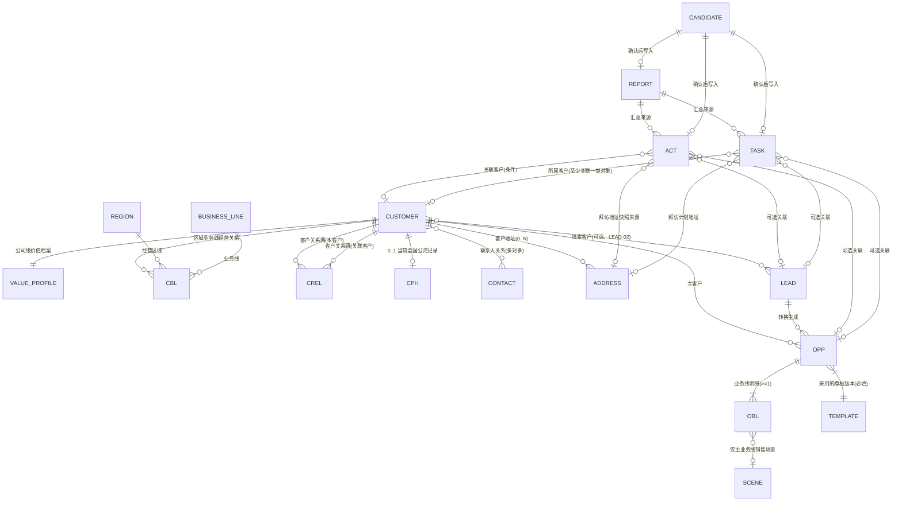

**范围澄清（重要）**：`DEC-059` 已取代 `DEC-025` 中经营单元公海口径。0.1 只建设一个全国公海，只收纳当前零条有效经营关系的客户主档。客户主档不保存负责人；认领或分派时原子结束公海记录并新建有效经营关系。线索池与全国客户公海的参数和记录不可混用。

### 4.2 客户主档 CUS

| 字段 | 类型 | 必填 | 说明与校验 | 级别 |
|---|---|---|---|---|
| 客户编号 | 文本 | 系统 | `CUS-YYYYMM-NNNN`，创建后不可变 | S2 |
| 客户名称 | 文本 | 是 | 2–100 字符；用于展示、搜索和疑似重复提示，不作为唯一识别依据（`CUST-03`） | S2 |
| 客户类型 | 枚举 | 是 | 集团客户／组织客户／个体工商户／自然人客户 | S2 |
| 统一社会信用代码 | 文本 | 条件 | 组织客户、个体工商户在主数据状态变为“正常”前必填；待治理状态允许暂缺。填写后全库唯一，冲突即提示并阻断新建或转正常 | S2 |
| 主数据状态 | 枚举 | 系统 | 正常；「待治理」是由异常事项派生的数据质量标签，不是记录状态 | S2 |
| 客户关系网摘要 | 关联摘要 | 否 | 从客户关系网派生展示关联客户与关系标签；不在客户主表保存通用父级 | S2 |
| 客户来源 | 枚举 | 否 | 来自线索转换时自动写入并只读 | S2 |
| 备注 | 长文本 | 否 | ≤1000 字符 | S2 |
| 创建人 / 创建时间 / 更新时间 | 系统 | 系统 | 审计字段 | S2 |

**自然人处理**：自然人客户**不采集完整身份证号**（`CUST-10`、`CUST-20`）；同一自然人既是自然人客户又是组织联系人时，复用受控人员身份索引，用角色与关系分开表达（`DEC-024`）。

### 4.3 客户价值档案

| 字段 | 类型 | 必填 | 说明与校验 | 级别 |
|---|---|---|---|---|
| 关联客户 | 关联 | 是 | 一对一 | S2 |
| 当前价值分级 | 枚举 | 否 | 战略／重点／普通／机会；空值显示“未分级”，不把“未分级”新增为价值枚举（`CUST-12`） | S2 |
| 最近调整人／时间 | 系统 | 条件 | 有权人员直接设置或调整后记录，与客户主档负责人是否为空无关 | S2 |
| 调整说明 | 长文本 | 条件 | 首次设置选填；再次调整必填（`CUST-13`） | S2 |
| 分级变更历史 | 子表 | 系统 | 每次设置或调整记录前后值、说明、操作人、时间；只增不改（`MGMT-02`） | S2 |

**集团规则**：集团客户与经营实体客户分别评定，集团等级**不得自动继承**到成员实体（`CUST-14`）。

**新客户规则**：客户主档可先创建，价值分级允许为空并显示“未分级”，不自动归入“机会”；看板将其计入“未分级”完整度。有客户价值编辑按钮权限且客户在数据范围内的人员可直接设置或调整，保存即生效并留日志；客户主档负责人为空不阻塞该操作。

### 4.4 客户—区域—业务线经营关系 CBL

| 字段 | 类型 | 必填 | 说明与校验 | 级别 |
|---|---|---|---|---|
| 关联客户 | 关联 | 是 | — | S2 |
| 经营区域 | 引用 | 是 | 引用公司区域／组织配置；同一客户在山东、上海等区域可分别建立关系 | S2 |
| 业务线 | 引用 | 是 | 引用业务线管理系统的稳定标识（`DATA-01`、`CUST-04`） | S2 |
| 维护销售 | 用户 | 否 | 最近维护优先级的销售，仅用于审计，不等于主负责人（`DEC-009`） | S2 |
| 变更历史 | 子表 | 系统 | 前后值、操作人、时间；0.1 **不设确认审批**（`DEC-009`） | S2 |
| 经营关系状态 | 枚举 | 是 | 有效／停止经营；全国公海占用作为独立流转事实 | S2 |
| 主负责人 | 用户 | 条件 | 有效关系恰好一个；停止经营时结束当前责任并保留历史 | S2 |
| 协作人 | 多用户 | 否 | 可多人；不拥有转移或停止等高影响动作，除非另行授权 | S2 |
| 保护期到期时间 | 日期时间 | 条件 | 从全国公海分派或认领后按全国公海规则生成 | S2 |
| 最近有效销售活动 | 日期时间 | 系统 | 由已确认销售活动回写，用于保护和回收规则 | S2 |
| 停止原因 | 枚举＋文本 | 条件 | 停止经营时必填并进入审计；若由此触发客户自动入池，同一原因进入公海记录 | S2 |

**唯一性**：同一 `客户＋经营区域＋业务线` 至多一条有效关系；具体业务选择区域和业务线后再匹配经营关系。

### 4.4A 全国公海占用记录 CPH

| 字段 | 类型 | 必填 | 说明与校验 | 级别 |
|---|---|---|---|---|
| 占用记录编号 | 文本 | 系统 | 稳定唯一 | S2 |
| 客户 | 关联 | 是 | 指向当前零条有效经营关系的客户主档 | S2 |
| 占用状态 | 枚举 | 是 | 有效／已结束；认领或分派成功后结束 | S2 |
| 入池时间／原因 | 日期时间／枚举＋文本 | 是 | 记录停止最后一条有效经营关系的时间与原因 | S2 |
| 入池前主负责人／协作人 | 历史快照 | 系统 | 仅用于审计；公海完整客户详情仍按历史记录的页面与按钮权限展示 | S2 |
| 结束时间／动作 | 日期时间／枚举 | 条件 | 认领或主管分派成功时填写 | S2 |
| 新主负责人 | 用户 | 条件 | 占用结束并建立新责任记录时填写 | S2 |

**唯一性与认领规则**：0.1 只有一个全国公海。同一客户同一时刻最多一条有效全国公海记录，且不能与任何有效经营关系并存。所有销售可查看完整客户详情；认领时必须选择区域和业务线，主负责人为当前认领人。认领无需审批，但必须校验动作权限、持有上限、保护规则、当前仍在公海且无有效经营关系，原子更新保证仅首个认领者成功。

### 4.4B 门店（不在 0.1 范围）

门店不进入 0.1（本次范围确认）。0.1 **不建立门店业务对象**：无门店编号、无门店业务线、无门店地址、无门店页面、无菜单入口和无专属权限。菜单／入口、原型页面、前端页面、业务逻辑和页面交互直接删除，不以大段代码注释保留旧实现；后续如需恢复，从现有备份重新取回并另行确认。本节编号占位保留，避免影响既有章节引用。

### 4.4C 客户关系网 CREL

客户关系网表达当前客户与其他客户之间的业务或组织关联。0.1 支持四类关系，采用轻量模型：

| 关系类型 | 建议关系标签 |
|---|---|
| 集团关系 | 集团总部／成员企业、母公司／子公司 |
| 总分关系 | 总公司／分公司、总部／分支机构 |
| 上游 | 供应商、服务商、品牌商／制造商 |
| 下游 | 经销商、代理商、渠道商、终端客户 |

| 字段 | 类型 | 必填 | 说明与校验 | 级别 |
|---|---|---|---|---|
| 关系编号 | 文本 | 系统 | `CREL-YYYYMM-NNNN`，创建后不可变 | S2 |
| 本客户 | 关联客户 | 是 | 当前正在维护的客户主体 | S2 |
| 关联客户 | 关联客户 | 是 | 关系另一端；不得与本客户相同（禁止自关联） | S2 |
| 关系类型 | 枚举 | 是 | 集团关系／总分关系／上游／下游；不允许自定义扩展 | S2 |
| 关系标签 | 枚举＋文本 | 是 | 默认从该关系类型给出的建议标签中选择；建议标签不覆盖时允许补充文本。仅用于快速识别关系性质 | S2 |
| 备注 | 长文本 | 否 | 承载合作模式、股权或控制情况、实际业务关系、品牌关系、特殊背景及其他说明 | S2 |
| 操作人／更新时间 | 系统 | 系统 | 关系新增、变更、删除均留痕 | S2 |

**关系约束**：关系标签只用于快速识别，不建设复杂关系模型。0.1 不建设股权比例、控股比例、实际控制人关系、关系有效期、关系权重、多层股权穿透、自定义关系类型或复杂关系审批／治理；上述信息统一写入备注，不单独增加结构化字段。关系不自动产生销售经营资格、负责人继承或数据权限，汇总和下钻仍逐主体鉴权。

**维护方向**：维护页按所选关系类型提供对应的关系标签建议，例如 `A 公司 → B 公司`，关系类型为集团关系、关系标签为母公司，持股情况与实际控制关系写在备注中。保存时只校验自关联、同一方向同一对客户＋关系类型＋关系标签的重复，不做关系环或唯一上级校验。

### 4.5 联系人 CON 与联系人关系 CR

| 字段（联系人） | 类型 | 必填 | 说明 | 级别 |
|---|---|---|---|---|
| 联系人编号 | 文本 | 系统 | `CON-YYYYMM-NNNN` | S2 |
| 姓名 | 文本 | 是 | 2–50 字符 | S2 |
| 手机号 | 文本 | 否 | 有权查看记录时展示完整值 | S3 |
| 微信号 / 邮箱 | 文本 | 否 | 同上 | S3 |
| 职务 / 所属单位 | 文本 | 否 | — | S2 |
| 身份证号 | 文本 | — | **0.1 不采集**（`CUST-10`） | S4 |

| 字段（联系人关系） | 类型 | 必填 | 说明 | 级别 |
|---|---|---|---|---|
| 关联客户 | 关联 | 是 | 多对多，一个联系人可关联多个客户（`CUST-08`） | S2 |
| 关联联系人 | 关联 | 是 | — | S2 |
| 角色 | 枚举 | 是 | 决策／影响／使用／采购／技术／财务／其他 | S2 |
| 部门 / 职务 | 文本 | 否 | 该客户内的任职表达 | S2 |
| 是否主要联系人 | 布尔 | 否 | 每个客户建议至少一个；不强制 | S2 |
| 有效状态 / 起止时间 | 系统 | 否 | 关系失效不物理删除 | S2 |

**客户关系网**统一见 §4.4C；联系人关系不承载客户之间的关联事实。

### 4.5A 客户地址 ADR

| 字段 | 类型 | 必填 | 说明 | 级别 |
|---|---|---|---|---|
| 地址编号 | 文本 | 系统 | `ADR-YYYYMM-NNNN`，创建后不可变 | S2 |
| 关联客户 | 关联 | 是 | 一个客户可有 0..N 条地址；地址不能脱离客户单独存在 | S2 |
| 地址类型 | 枚举 | 是 | 注册地址／办公地址／经营地址／项目或服务地址 | S2 |
| 省市区／详细地址 | 结构化文本 | 是 | 省市区用于筛选，详细地址用于展示和导航 | S2 |
| 关联业务线／项目／联系人 | 关联 | 否 | 仅表达业务用途，不作为主体身份识别依据 | S2 |
| 来源与来源说明 | 枚举＋文本 | 是 | 客户提供／销售核实／公开信息／下游同步／其他；下游同步需保存来源标识 | S2 |
| 有效状态／起止时间 | 系统 | 是 | 有效／失效；失效不物理删除，历史业务记录仍显示地址快照 | S2 |
| 创建人／更新时间 | 系统 | 系统 | 用于审计和可信度判断 | S2 |

**资料维护边界**：客户地址不是主体唯一识别依据，统一社会信用代码仍是组织客户和个体工商户的主识别依据。注册地址由有相应编辑权限的人员（含获授权的 管理员（运营））直接修改并立即生效；办公、经营、项目或服务地址由有权经营范围内的销售维护。客户资料不建设独立治理流程，全部修改进入客户详情「历史」。拜访任务引用地址记录，签到完成后销售活动保存当时的地址快照；之后修改客户地址不得改写历史销售活动。

### 4.6 线索 LED

| 字段 | 类型 | 必填 | 说明与校验 | 级别 |
|---|---|---|---|---|
| 线索编号 | 文本 | 系统 | `LED-YYYYMM-NNNN` | S2 |
| 原始内容 | 长文本 | 是 | **保留导入或人工录入的原始信息，不被清洗结果覆盖**（`LEAD-01`） | S2 |
| 来源 | 枚举 | 是 | 市场活动／转介绍／销售挖掘／外部名单／纷享销客迁移／其他 | S2 |
| 客户 | 关联 | 否 | **允许为空**，不为满足关联而创建模糊客户（`LEAD-02`） | S2 |
| 候选业务线 | 多选 | 否 | 引用业务线；可空、可多选 | S2 |
| 候选产品 | 多选 | 否 | 只能引用业务线管理系统中的有效产品 | S2 |
| 线索业务状态 | 枚举 | 是 | 待处理／跟进中／已转化／无效（`LEAD-09`） | S2 |
| 当前线索池 | 关联 | 条件 | 活跃且无负责人时必填；有负责人时必须为空；终态清空 | S2 |
| 来源线索池 | 关联 | 否 | 从池分派或认领时保存，用于按来源池统计持有量；后续转交不再计入原池持有量 | S2 |
| 负责人 | 用户 | 条件 | 活跃线索与当前池二选一；终态保留已有负责人用于展示和历史追溯，但不代表活跃经营责任 | S2 |
| 保护期到期时间 | 日期时间 | 条件 | 认领或分派时按池参数生成（`LEAD-10`） | S2 |
| 下一步动作 | 文本 | 条件 | **状态为跟进中时必填**，确保线索不是无动作记录 | S2 |
| 下次跟进时间 | 日期时间 | 条件 | 状态为跟进中时必填，驱动临期提醒 | S2 |
| 最后跟进时间 | 日期时间 | 系统 | 由销售活动记录回写 | S2 |
| 无效原因 | 枚举 | 条件 | 状态为无效时必填 | S2 |
| 拆分来源 | 关联 | 条件 | 由其他线索或商机拆分而来时必填（`LEAD-06`） | S2 |
| 转化关系 | 子表 | 条件 | 已转化时必填，见 §4.15 | S2 |
| 创建人 / 创建时间 | 系统 | 系统 | 即使线索重复也保留来源和到达时间 | S2 |

**约束**：原线索不能被改成客户或商机对象；**仅为线索补充客户或联系人不等于完成转化**（`LEAD-05`、`state-machine.md` §1）。

### 4.7 商机 OPP

| 字段 | 类型 | 必填 | 说明与校验 | 级别 |
|---|---|---|---|---|
| 商机编号 | 文本 | 系统 | `OPP-YYYYMM-NNNN` | S2 |
| 商机名称 | 文本 | 是 | 2–100 字符 | S2 |
| 客户 | 关联 | 是 | 恰好一个当前客户；正常和待治理客户可选（`OPP-02`、`OPP-06`） | S2 |
| 统一管理阶段 | 枚举 | 是 | 五个统一管理阶段之一（`OPP-05`） | S2 |
| 详细操作阶段 | 引用 | 条件 | 由流程模板决定，展示在统一阶段之下 | S2 |
| 流程模板版本 | 系统 | 是 | 创建时按「主业务线 + 销售场景」匹配并**冻结版本**（`OPP-14`） | S2 |
| 流程状态 | 枚举 | 是 | 进行中／已结束 | S2 |
| 负责人 | 用户 | 是 | 整条商机一个负责人（`OPP-13`） | S2 |
| 预计成交时间 | 日期 | 条件 | 创建时允许为空；从「机会确认」推进至后续统一管理阶段前必须补齐，后续改期保留变更历史 | S2 |
| 已结束结果 | 枚举 | 条件 | 赢单／输单／关闭；已结束时必填（`OPP-07`） | S2 |
| 成交依据类型 | 枚举 | 条件 | 赢单时必填；合同／订单／采购确认／入围或框架确认／其他 | S2 |
| 结束原因 | 枚举 | 条件 | 输单或关闭时必填，见 §3.2 | S2 |
| 关闭说明 | 长文本 | 条件 | 成交依据或关闭原因选择“其他”时必填，其余选填 | S2 |
| 来源线索 | 关联 | 条件 | 由线索转换生成时必填（`LEAD-04`） | S2 |
| 拆分来源 | 关联 | 条件 | 由原商机协同业务线主动拆分而来时必填（`OPP-09`） | S2 |

### 4.8 商机业务线明细 OBL

| 字段（明细） | 类型 | 必填 | 说明与校验 | 级别 |
|---|---|---|---|---|
| 明细编号 | 文本 | 系统 | `OBL-YYYYMM-NNNN` | S2 |
| 关联商机 | 关联 | 是 | — | S2 |
| 业务线 | 引用 | 是 | 引用业务线管理系统稳定标识（`OPP-04`） | S2 |
| 明细角色 | 枚举 | 是 | **主业务线恰好一条**，其余为协同业务线（`OPP-03`） | S2 |
| 销售场景 | 枚举 | 条件 | 仅主业务线必填并用于匹配模板；协同业务线不选择场景（`OPP-03`、`OPP-11`） | S2 |
| 业务范围 | 长文本 | 否 | 本条明细涉及的范围描述 | S2 |
| 参与状态 | 枚举 | 系统 | 当前参与／已移除／已拆出／停止参与；有历史数据时不物理删除 | S2 |
| 拆分去向 | 关联 | 条件 | 协同业务线拆出后指向新商机 | S2 |

**硬约束**：协同业务线明细**不单独维护**阶段、负责人、预计成交时间和关闭结果；需要独立维护时必须拆分为新商机并保存来源（`OPP-13`、`state-machine.md` §2）。

### 4.9 商机客户变更历史

商机不建设多客户关系对象。当前客户直接保存在商机；每次变更追加保存 `原客户 / 新客户 / 操作人 / 操作时间`。原客户不自动转为参与客户；已结束（关闭）商机需先重新激活，赢单和输单不可重新激活。

### 4.9A 工商信息快照与客户关系网

工商信息自动查询与更新为 0.1 P0。组织客户、个体工商户建档时，以企业名称或统一社会信用代码查询候选企业，由用户选择准确主体并确认后写入客户主档。至少带出法定名称、统一社会信用代码、登记状态、法定代表人、注册资本、成立日期、注册地址、行业、经营范围、数据来源、查询时间和外部版本。查询无结果、超时或服务不可用时允许创建“待治理”客户，但不得伪造工商字段；恢复后生成补全任务。

定期刷新或人工刷新只形成差异候选。法定名称、信用代码、登记状态、注册地址等主档字段不得被第三方数据静默覆盖；有相应编辑权限的人员（含获授权 管理员（运营））查看前后值、来源和更新时间后确认更新，修改进入「历史」。第三方工商数据中的股东、投资方或控制信息仅作为带来源与查询时间的工商快照展示，不自动创建客户、不写入客户关系网，也不参与权限、经营资格或汇总。

客户关系网只表达当前客户与其他客户之间的业务或组织关联，采用关联客户＋关系类型＋关系标签＋备注的轻量模型；四类关系（集团关系、总分关系、上游、下游）、字段与约束见 §4.4C。股权比例、控股比例、实际控制人关系、合作模式、品牌关系、特殊背景及其他补充统一写在备注中，不单独增加结构化字段，也不由工商快照自动推导。客户关系网不自动产生销售经营资格、负责人继承或数据权限。

### 4.9B 联系人关系、联系记录与地址

联系人基础档案增加姓名、性别（可空）、手机、座机、邮箱、微信/企微标识、常用沟通方式、适合联系时间、备注、来源和敏感级别。客户关系继续保存部门、职务、决策链角色、是否主要联系人和有效期，避免覆盖联系人基础资料。

联系人联系记录统一引用销售活动；电话记录至少保存呼入/呼出、号码、开始时间、接通状态、时长、通话结果、关联销售、客户、商机及来源系统。录音与转写只有在接口、授权、保存期限和权限均满足时展示；无电话系统接口时允许手工记录结果。

联系人之间通过独立关系边表达上下级、同事、助理、引荐、影响、亲属/其他关系，保存方向、说明、来源、置信/核验状态、有效期；未经核验的推断不得作为正式关系。联系人地址包含工作地址、常用联系地址、邮寄地址和私人地址；工作地址可引用客户地址，私人地址默认不采集，确需采集按 S3 单独授权和审计。

### 4.9C 商机团队与详情状态

商机有且仅有一个主负责人，并可配置多个团队成员。团队成员只记录人员、一个团队角色（协同销售/方案/产品/交付/法务/财务/其他）及历史；角色仅作主要职责标记，不决定字段、阶段、任务或业务线权限。加入团队自动获得商机记录级查看权，移除后仅由团队关系产生的权限立即失效；关联任务仍按统一任务权限判断。

商机详情同时展示流程状态（进行中/已结束）、统一阶段、详细阶段、已结束结果、阶段门槛、负责人和团队；停滞仅为提醒，不作为流程状态。信息架构固定为：概览及普通字段、流程阶段、业务线、团队、销售活动与有权任务、统一业务时间线。普通字段默认只读，按按钮权限进入编辑。自定义字段配置、竞争信息和 AI 摘要不进入 0.1 商机核心范围。

### 4.10 销售活动 ACT

销售活动是任务、日报和 Agent 的事实来源之一。正式拜访是使用稳定 `visit_id` 的独立对象，在活动中心和时间线中只作投影，不复制记录。

| 字段 | 类型 | 必填 | 说明 | 级别 |
|---|---|---|---|---|
| 销售活动编号 | 文本 | 系统 | `ACT-YYYYMM-NNNN` | S2 |
| 销售活动类型 | 枚举 | 是 | 电话／消息／邮件／会议／拜访／手工纪要／其他 | S2 |
| 发生时间 | 日期时间 | 是 | 默认当前时间，可回填 | S2 |
| 关联对象 | 关联 | 是 | 至少关联一个客户／联系人／线索／商机／任务；关联未识别客户的线索时客户可空，且不得为满足关联强建模糊客户；关联商机时自动继承并锁定商机主客户；从客户或联系人直接创建时客户必填 | S2 |
| 关联联系人 | 关联 | 否 | 可多选 | S2 |
| 实际沟通人 | 文本 | 否 | 记录本次实际参与沟通者的姓名或称谓，可填写多人；已建档者可同时关联联系人，未建档者不强制创建正式联系人 | S3 |
| 决策链角色 | 文本 | 否 | 记录实际沟通人在本次事项中的决策、影响、使用等角色；未明确时可后补 | S3 |
| 客户诉求与顾虑 | 长文本 | 否 | 要素二 | S3 |
| 预算与时间节点 | 文本 | 否 | 要素三 | S3 |
| 决策流程 | 长文本 | 否 | 要素四 | S3 |
| 竞品动态 | 长文本 | 否 | 要素五 | S3 |
| 共识与承诺 | 长文本 | 否 | 要素六；形成客户承诺时提示转为任务（`WORK-07`） | S3 |
| 内部支持需求 | 长文本 | 否 | 要素七 | S3 |
| 下一步责任人与时间 | 文本 + 日期 | 否 | 要素八；与`WORK-07`联动生成候选任务 | S3 |
| 内容摘要 | 长文本 | 否 | 原始记录，保留客户原话 | S3 |
| 来源 | 枚举 | 是 | 手工录入／沟通提炼确认／Agent 候选确认／渠道同步／迁移 | S2 |
| 原件引用 | 关联 | 否 | 0..N；录音、截图、邮件、附件或渠道稳定引用，保存来源、哈希、权限、保留、保全和处置状态 | S4 |
| AI 摘要版本 | 子表 | 否 | 摘要可修订并留版本，始终追溯对应原件和来源 | S3 |
| 来源锚点 | 关联 | 条件 | 来源为 Agent 候选时必填（`WORK-05`） | S2 |
| 外勤签到 | 结构 | 条件 | 拜访销售活动可记录签到时间、用户授权后的位置、现场图片、异常原因；位置不可用时允许手工说明，不记录连续轨迹 | S3 |
| 拜访地址快照 | 结构 | 条件 | 拜访销售活动保存地址编号、当时的完整文本地址及定位结果；客户地址后续修改不得回写历史销售活动 | S3 |

> 0.1 将八项纪要要素设为**可后补字段**，不做提交时强校验；未补齐时进入数据完整度统计（`MGMT-06` 的时限口径属配置层）。

### 4.11 任务候选 TCAN 与正式任务 TSK

| 字段 | 类型 | 必填 | 说明 | 级别 |
|---|---|---|---|---|
| 任务编号 | 文本 | 系统 | `TSK-YYYYMM-NNNN` | S2 |
| 标题 | 文本 | 是 | ≤80 字符 | S2 |
| 展示来源 | 枚举 | 是 | 自建任务／主管指派／沟通提炼／规则生成（`WORK-01`） | S2 |
| 生成方式 | 枚举 | 是 | 人工／沟通提炼／确定性规则／Agent 建议；与展示来源分开 | S2 |
| 任务类型 | 枚举 | 否 | 首次触达／跟进／拜访／方案／报价／内部协同／其他 | S2 |
| 责任人 | 用户 | 是 | 默认当前用户；上级分派时可选他人 | S2 |
| 创建人 | 用户 | 系统 | — | S2 |
| 截止时间 | 日期时间 | 是 | 驱动到期与逾期提醒；会议任务由会议结束时间自动写入，不单独录入 | S2 |
| 计划开始／结束时间 | 日期时间 | 条件 | 会议任务仍以任务为主对象，创建时必填会议开始／结束时间且结束须晚于开始；会议结束时间即任务截止时间，改期时同步更新；有开始时间时任务列表展示“开始时间—截止时间”，没有则只展示截止时间；会议任务按会议时间在日历投影 | S2 |
| 会议方式与地点／链接 | 枚举＋文本 | 条件 | 会议任务必选线上或线下；线上必填会议链接，线下必填地点；参与人与其他任务共用字段，一期不发送企微邀请 | S2 |
| 计划地点 | 文本 | 否 | 拜访任务可填写；不得替代客户地址主数据 | S3 |
| 客户地址 | 关联 | 条件 | 拜访任务优先选择一条有效客户地址；临时地点时可空，并保留计划地点文本 | S2 |
| 状态 | 枚举 | 是 | 正式任务：待处理／已完成／已取消；阶段上下文失效由系统取消并记录原因 | S2 |
| 时间状态 | 派生 | 系统 | 正常／即将到期／已逾期；不覆盖主状态 | S2 |
| 关联对象 | 关联 | 否 | 客户／联系人／线索／商机／销售活动；普通内部任务可空，规则任务必须关联触发对象，沟通提炼必须关联来源销售活动 | S2 |
| 参与人 | 多用户 | 否 | 会议任务、其他任务统一从公司全部人员中按姓名、部门、工号查询多选；负责人不重复列入；多人参与同一任务 ID，可补充记录与本人成果，不复制正式任务 | S2 |
| 创建权限 | 规则 | 系统 | 创建后直接待处理；负责人完成，创建人改期或取消 | S2 |

| 完成凭证要求 | 配置快照 | 否 | 完成说明、附件、关联销售活动等要求 | S2 |
| 任务描述 | 长文本 | 否 | — | S3 |
| 执行结果 | 长文本 | 条件 | 完成时按任务类型配置必填；不进入验收流程 | S3 |
| 取消原因 | 文本 | 条件 | 已取消时必填 | S2 |
| 来源锚点 | 关联 | 条件 | 来源为系统生成时必填，并标明生成方式为确定性规则或 Agent，指向生成依据（`WORK-05`） | S2 |
| 完成时间 | 日期时间 | 条件 | 负责人完成时写入 | S2 |
| 改期日志 | 日志 | 否 | 截止时间前后值、原因、创建人和操作时间 | S2 |
| 企微日程同步 | 结构 | 否 | 是否同步、外部日程 ID、同步状态、最后时间、失败原因和重试次数 | S2 |

任务候选另存 `候选编号／建议字段／来源销售活动或触发对象／生成方式／生成理由／状态／确认人和时间／正式任务 ID`。候选状态为待确认、已确认、已忽略、已失效；确认或修改后确认才创建正式任务。

**硬约束**：任务业务类型、来源、生成路径和成果要求分开建模。所有来源创建的正式任务直接待处理；一个任务 ID、一个负责人、多个可选参与人。任务与正式拜访可建立 0..1 双向关联，但状态不自动联动。逾期只计算标识。

### 4.12 日报 RPT

| 字段 | 类型 | 必填 | 说明 | 级别 |
|---|---|---|---|---|
| 日报编号 | 文本 | 系统 | `RPT-YYYYMM-NNNN` | S2 |
| 日报日期 | 日期 | 是 | 「责任人 + 日期」唯一 | S2 |
| 责任人 | 用户 | 是 | — | S2 |
| 状态 | 枚举 | 是 | 草稿／已提交（`WORK-14`） | S2 |
| 今日完成事项 | 结构引用 | 条件 | **引用当日正式销售活动与任务**，不重复填报（`WORK-06`） | S2 |
| 关键进展 | 长文本 | 否 | 含客户原话依据 | S3 |
| 未完成事项及原因 | 长文本 | 否 | 引用未闭环任务 | S2 |
| 需协助问题 | 长文本 | 否 | 触发主管可见标记 | S3 |
| 明日重点候选 | 结构引用 | 否 | 来自次日候选任务 | S2 |
| 数据缺失提示 | 系统 | 系统 | 缺纪要、缺责任人承诺、缺下一步的沟通 | S2 |
| 主管建议 | 关联列表 | 否 | 建议人、建议内容、时间；不改动正文和状态（`WORK-14`） | S3 |
| 主管阅读状态 | 关联列表 | 系统 | 每名有权主管独立未读／已读、最后阅读时间、标回未读 | S2 |
| 提交人／提交时间 | 系统 | 条件 | 销售点击一次提交时写入 | S2 |
| AI 原始底稿 | 版本 | 条件 | AI 生成时保存不可覆盖快照及来源；不是日报状态 | S3 |
| 历史版本 | 子表 | 系统 | 保存 AI 底稿、销售草稿和唯一提交版本 | S2 |

**一步提交**：系统生成草稿后在工作台显示“待本人确认”提示；销售编辑并点击“提交日报”一次即进入已提交，之后不可退回、重提或编辑。主管默认看销售提交版，可在有权限时展开 AI 底稿和来源；打开自动标记本人已读，可标回未读并追加无需回复的建议，但不能编辑正文或改变状态。

### 4.13 Agent 候选记录 CAN

| 字段 | 类型 | 必填 | 说明 | 级别 |
|---|---|---|---|---|
| 候选编号 | 文本 | 系统 | `CAN-YYYYMM-NNNN` | S2 |
| 候选类型 | 枚举 | 是 | 候选销售活动／候选任务；日报采用独立版本模型 | S2 |
| 生成时间 | 日期时间 | 系统 | — | S2 |
| 读取来源（来源锚点） | 结构 | 是 | 来源对象、来源名称、来源更新时间、摘录（`WORK-05`） | S2 |
| 关联对象 | 关联 | 条件 | 指向客户／线索／商机 | S2 |
| 候选内容 | 结构 | 是 | 按候选类型的字段结构生成 | S3 |
| 信息性质标记 | 枚举 | 是 | **事实／推断／缺失** 三态必标（`WORK-05`） | S2 |
| 候选状态 | 枚举 | 是 | 待确认／已确认／已忽略／已失效 | S2 |
| 确认方式 | 枚举 | 条件 | 直接确认／修改后确认／批量确认 | S2 |
| AI 原建议／用户最终值／修改差异 | 结构 | 条件 | 修改后确认时保留，不新增状态 | S3 |
| 写入状态 | 枚举 | 是 | 未写入／写入中／写入成功／写入失败 | S2 |
| 确认人 / 确认时间 | 系统 | 条件 | — | S2 |
| 写入结果 | 关联 | 条件 | 指向正式对象 ID；失败时保留错误码、失败原因和原幂等键 | S2 |

### 4.14 提醒（系统派生记录）

提醒不单独编号，由规则从正式事实派生，字段为：`提醒类型 / 关联对象 / 触发时间 / 触发依据（规则标识 + 参数值）/ 状态 / 处理人 / 处理时间 / 备注原因`。

**规则**：提醒**必须能追溯到触发它的规则与参数值**，不得出现无依据提醒（`MGMT-04`）；AI 推断的风险以候选信息展示，与确定性提醒在界面上明确区分。

### 4.15 流程模板与转化／拆分来源

| 对象 | 关键字段 |
|---|---|
| 统一阶段库 | 阶段标识 / 阶段名称 / 映射的统一管理阶段 / 适用业务线范围 / 是否启用 |
| 版本化模板 TPL | 模板标识与版本号 / 主业务线 / 销售场景 / 阶段序列与统一阶段映射 / 必填字段 / 阶段任务 / 停滞天数 / 版本状态（草稿·生效·历史·停用）/ 发布时间 |
| 商机实例 | 当前客户 / 采用的模板版本 / 当前详细阶段 / 当前统一阶段 / 阶段历史 / 迁移历史 / 过程状态 / 关闭历史 |
| 转化／拆分来源 | 来源对象类型与编号 / 目标对象类型与编号 / 关系类型（转化·拆分）/ 原因 / 业务范围 / 操作人 / 时间 / 字段映射版本 / 失败信息 |

**硬约束**：模板更新不得静默改变存量商机；同一匹配键最多一个生效版本；生效版本不可修改；模板只引用本期已有普通字段。

### 4.16 公共字典（0.1 初始值）

| 字典 | 初始枚举值 | 是否可配置 |
|---|---|---|
| 线索来源 | 市场活动 · 转介绍 · 销售挖掘 · 外部名单 · 纷享销客迁移 · 其他 | 是（管理员（运营）） |
| 线索无效原因 | 无需求 · 联系不上 · 重复线索 · 信息错误 · 竞品已签 · 其他 | 是（管理员（运营）） |
| 任务类型 | 首次触达 · 跟进 · 拜访 · 方案 · 报价 · 内部协同 · 其他 | 是（管理员（运营）） |
| 任务生成方式 | 人工 · 沟通提炼 · 确定性规则 · Agent 建议 | 否（系统字典） |
| 销售活动类型 | 电话 · 消息 · 邮件 · 会议 · 拜访 · 手工纪要 · 其他 | 是（管理员（运营）） |
| 候选拒绝原因 | 不准确 · 已处理 · 对象不对 · 不需要 · 其他 | 是（管理员（运营）） |
| 联系人关系角色 | 决策 · 影响 · 使用 · 采购 · 技术 · 财务 · 其他 | 是（管理员（运营）） |
| 销售场景 | 标准销售 · 项目制 · 入围 · 其他（按业务线配置） | 是（管理员（运营）） |

---

## 5. 端到端主流程

### 5.1 0.1 主闭环

依据 `system-functional-modules.md` §3 的端到端能力链：

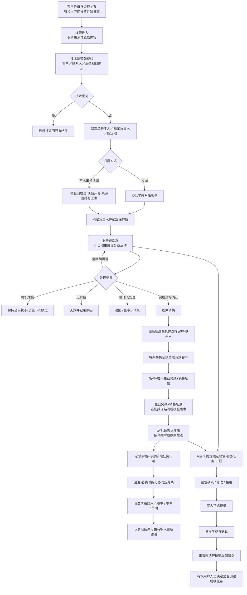

**主链条上的三个不可省略节点**：任务、日报、Agent 人工确认。任意一个缺失都会破坏闭环（`system-functional-modules.md` §3）。Agent 候选的触发源包括销售活动记录（M）、任务执行（L）和商机阶段推进（W），不限于此三处——只要产生正式事实即可触发候选提炼。

### 5.2 子流程 1：线索进入、查重与派领

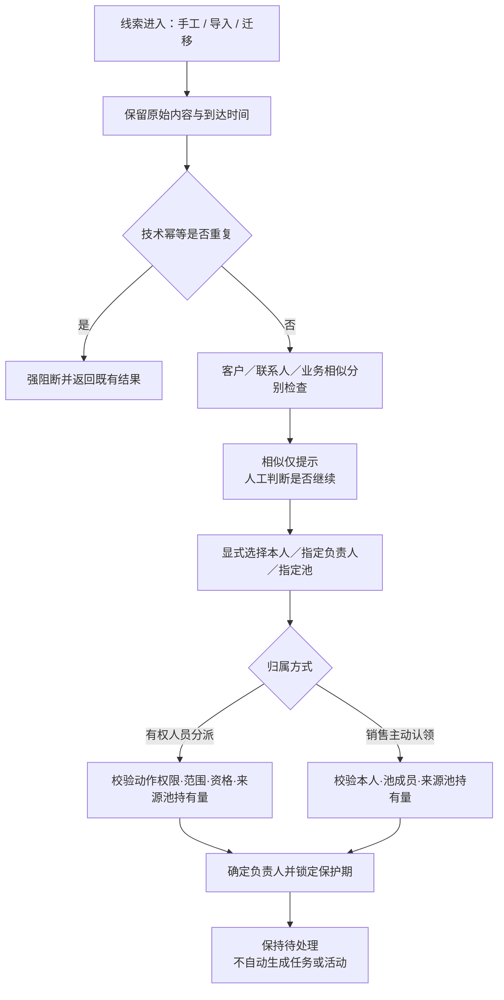

**落地要点**：

1. 创建只强制原始内容和线索来源；客户、联系人、联系方式、候选业务线和外部记录 ID 均可为空，结构化不足只做非阻断提示。
2. 客户、联系人、业务相似和技术幂等分别检查；只有技术重复强阻断，业务相似只提示。业务查重异常可降级，技术幂等不可降级。
3. 主动认领只能认领给本人；服务器原子校验保证并发只有一人成功。失败方收到不泄露他人信息的统一提示。
4. 达到某来源池持有上限只阻止该池新的分派或认领，不影响已有线索；池成员在认领前可查看完整线索信息。

### 5.3 子流程 2：线索跟进、退回与回收

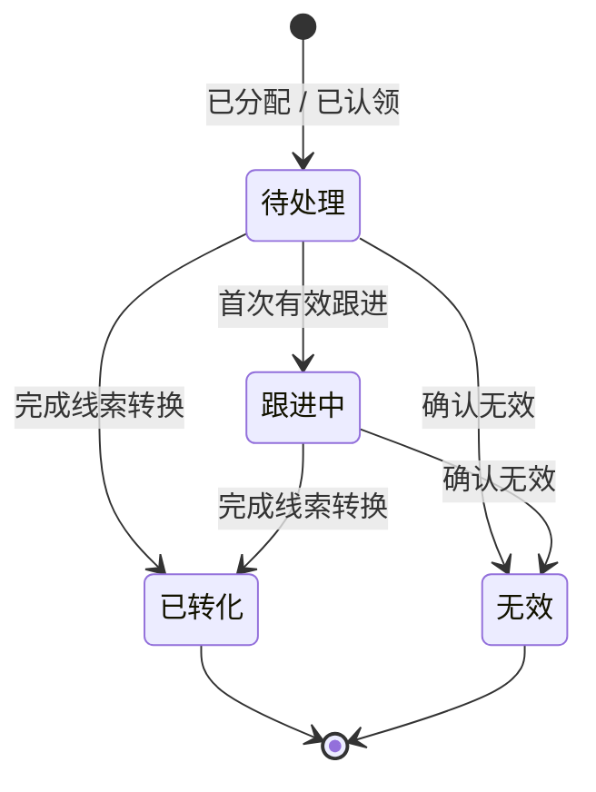

**落地要点**：

1. 进入跟进中必须同时保存正式销售活动、下一步动作和下次跟进日期；暂不成熟时通过下一步与下次跟进时间安排处理。销售活动、任务完成和 Agent 建议均不自动改状态。
2. 保护期临期与到期只提醒；到期不自动回收、不清负责人、不改状态，活动也不自动续期。续期由有权人员显式执行并填写原因。
3. 转交不经过池；退回和回收清负责人及保护期并进入有效目标池，业务状态不变。既有任务只提示，不自动转派、取消或改期。
4. 已转化和无效清当前池、保护期及提醒并退出持有量；已有负责人继续用于展示和历史追溯，但不再代表活跃经营责任。误判无效可由有权人员撤销并恢复原状态、归属和原保护截止时间。

### 5.4 子流程 3：线索转换

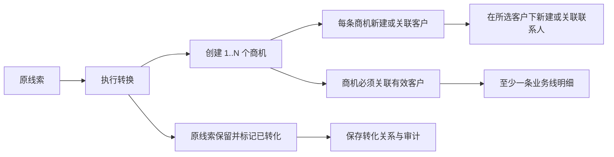

**落地要点**：

1. 待处理和跟进中均可发起转换，不要求已有销售活动；转换前分别检查客户、联系人和技术幂等。
2. **原线索不能被改成客户或商机对象**（`LEAD-01`、`state-machine.md` §1）。
3. 转换必须至少新建一条正式商机；每条商机独立选择客户，可在所选客户下关联或新建联系人。正式联系人和商机必须关联有效客户；可在同一事务中先新建客户再创建商机。
4. 一次转换可以创建多个彼此独立的商机；每条商机可分别关联已有客户或新建客户。
5. 转换是用户可见的完整事务：全部成功后才更新源线索；任一步失败则整体失败，不展示部分成功或子项重试。
6. 转化关系至少记录源线索、目标对象、新建或关联方式、操作者、时间、结果和字段映射版本；成功后清当前池和保护期，已有负责人保留作历史展示。

### 5.5 子流程 4：商机创建与阶段推进

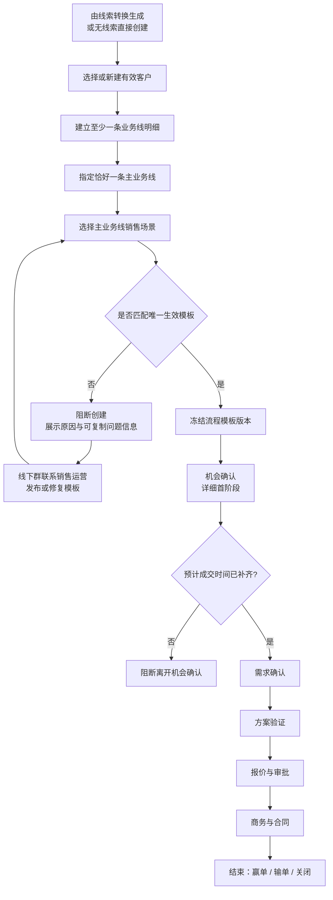

**落地要点**：

1. 正式商机必须关联有效客户；正常和待治理客户可用。仅有模糊信息时继续作为线索（`OPP-02`）。
2. 创建时**至少一条业务线明细，且只能有一条主业务线**（`OPP-03`、`DEC-027`）；同一商机内同一业务线不得重复添加。
3. 主业务线 + 销售场景共同匹配**一个有效流程模板**；商机保存实际采用的模板版本，模板更新不静默改变历史商机（`OPP-11`、`OPP-14`）。
4. 所有模板从映射机会确认的首个详细阶段开始，阶段按顺序推进，不允许跳级。预计成交时间是离开机会确认前不可关闭、不可绕过的系统固定门槛。
5. 主业务线或场景变化导致模板改变时显式迁移；主业务线、场景、模板版本、当前详细阶段和统一阶段原子更新。
6. 0.1 阶段门槛只支持必填字段和必须完成阶段任务；任务、活动、规则和 Agent 不自动推进阶段。
7. 无唯一生效模板时不自动套用通用模板，也不创建“待配置”商机；修复配置后按原组合重试。
8. 创建被阻断期间，销售仍可保留/跟进线索、维护客户联系人、记录活动并创建任务日程；只阻断正式商机创建。

### 5.6 子流程 5：商机结束、重新激活与主动拆分

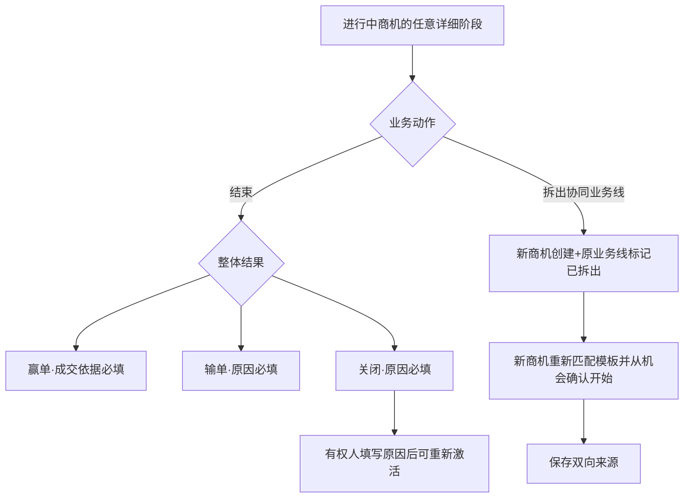

**落地要点**：

1. 商机在任意详细阶段可赢单、输单或关闭，结束不校验当前阶段门槛；0.1 不支持部分赢单。
2. 赢单成交依据、输单/关闭原因按 §3.2 校验；选择“其他”时说明必填。
3. 仅已结束（关闭）可由主管或拥有独立能力的人重新激活，恢复结束前阶段和冻结模板，原结束事件永久保留；赢单、输单不可重新激活。
4. 主动拆分仅选择协同业务线并创建新商机；新商机不继承原阶段、活动、任务、团队、原商机其他普通字段值和关键日期。
5. 新商机创建与原业务线标记已拆出属于同一事务，失败全部回滚，重复提交不产生重复新商机。
6. 停滞仅作为进行中商机的风险提醒，不改变流程状态。

### 5.7 子流程 6：销售活动记录与候选确认

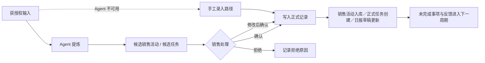

**落地要点**：

1. 候选内容必须区分**事实／推断／缺失**三类信息，不得把无法核实的推断伪装成事实（`WORK-05`）。
2. 每条候选显示「**为什么生成、来自哪里、数据何时更新**」三要素（`sales-workday-service-blueprint.md` §7.1）。
3. 同一事项不因出现在多个来源而重复生成任务；重复候选**合并展示来源**（§7.2、§8）。
4. 候选被拒绝时记录原因供规则优化，但**不强迫填写长说明**（§7.4）。
5. Agent 不可用时手工路径功能完整，不降级（`WORK-09`）。
6. 任务候选确认后创建正式任务；候选本身使用已确认状态并保存正式任务 ID，不与正式任务状态混用。
7. 销售活动可以关联原件；普通用户不可改写原件，AI 摘要修订需留版本和原件追溯。
8. 记录人发现普通销售活动结构化内容错误时，通过“修订”保存新版本并必填原因，历史版本与原件不变；已完成拜访仅追加补充说明、补充附件或纠错记录，不覆盖签到签退和定位事实（`WORK-36`）。

### 5.8 子流程 7：日报生成、一次提交、阅读与建议

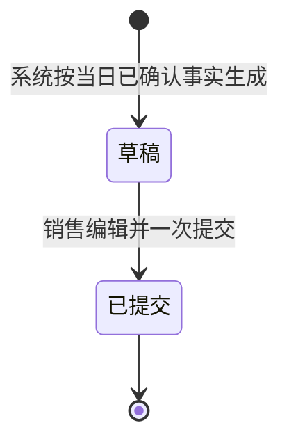

**落地要点**：AI 生成原始底稿快照，同时创建销售可编辑草稿；“待本人确认”只进入工作台待办，不写入日报状态。销售点击一次“提交日报”即进入已提交并冻结正文。每名有权主管单独维护读状态并可追加建议；建议不要求销售回复，不改变日报状态，也不自动创建任务。

**落地要点**：

1. 日报**来源于当日已确认的客户、线索、商机、销售活动和任务变化**，不要求重复填报系统已有事实（`WORK-06`、`MGMT-10`）。
2. 主管可查看、标回未读和追加建议，**不能退回、要求重提或修改销售报告**（`WORK-14`）。
3. 不提供退回、重提和提交后编辑接口；AI 底稿、草稿与提交版本可追溯。
4. 日终仍有未确认草稿时保存并提示，**不自动作为正式日报推送**。
5. 日报支持随时手工生成；系统定时生成和提醒节点由配置决定，未配置时不影响手工闭环。
6. 主管建议不提供自动“转为任务”；如需后续动作，由有权用户另行创建任务或任务候选。
7. H5“我的日报”默认打开当日，可按日期切换或从历史列表进入本人过去日报；历史页只读展示销售提交版和上级建议，不因查看历史而产生新版本。

### 5.9 子流程 8：客户价值分级与区域业务线经营关系

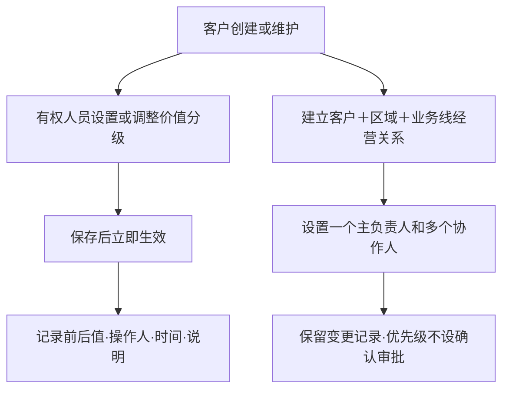

**落地要点**：

1. 一个客户只有一个公司级价值分级，允许未分级；集团与成员分别维护（`CUST-12`）。
2. 有权人员设置或调整后立即生效；不建设主管复核、复核状态、7 天期限或审批流。
3. 首次设置说明选填，再次调整说明必填；每次变更记录前后值、操作人、时间和说明。
4. 集团与经营实体分别评定，集团等级不自动继承（`CUST-14`）。
5. 客户主档负责人允许为空；销售责任按“客户＋区域＋业务线”维护，同一经营单元一个主负责人、多个协作人。同一客户在山东、上海等区域可由不同销售负责（`CUST-21`）。
6. 0.1 不建设系统／AI 价值建议、复杂评分、周期复核或区域业务线经营优先级。

### 5.10 子流程 9：客户公海流转

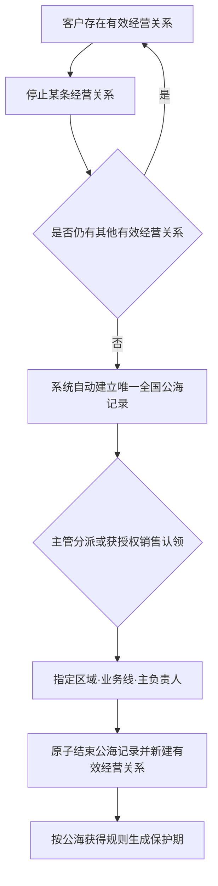

**落地要点**：

1. 全国公海收纳零条有效经营关系的客户主档，不承载某条待分配经营关系。
2. 0.1 只有一个全国公海，不建设区域公海、区域优先路由、多池或跨池转移。
3. 同一客户同时最多一条有效全国公海记录，且不得与任何有效经营关系并存。
4. 所有销售可查看全国公海客户的完整详情；认领仍需独立按钮权限及资格校验。
5. 认领或分派时必须指定区域、业务线和主负责人；成功后原子结束公海记录并新建有效经营关系。
6. 停止经营与入池判定在同一事务中完成；不提供「释放至全国公海」或「退回公海」独立动作。
7. 并发认领只允许一个请求成功；失败请求不产生经营关系。

### 5.10A 子流程 10：客户关系网维护

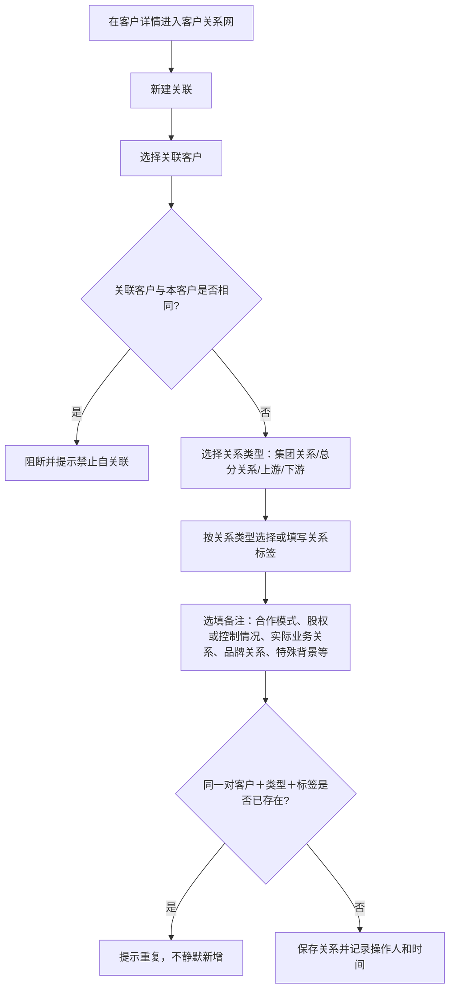

**落地要点**：客户关系网只表达客户与其他客户之间的业务或组织关联，采用关联客户＋关系类型＋关系标签＋备注的轻量模型；关系标签用于快速识别，不建设复杂关系模型。0.1 不校验关系环、唯一上级或有效期，也不建设股权比例、控股比例、实际控制人、关系权重、多层穿透、自定义关系类型和复杂关系审批／治理；关系不自动产生经营资格、负责人继承或数据权限。门店能力整体退出 0.1（原 `CUST-22`～`CUST-26` 相关口径不再作为本期能力）。

---

## 6. 页面结构与行为索引

0.1 的页面清单、稳定 `PG-xxx` 契约、端形态、入口、页面状态与交互细则统一见 [00-产品结构与页面清单](prd/00-产品结构与页面清单.md) §11。00 保留原总 PRD `6.x` 编号；本文后续的 `§6.x` 引用均指 00 中同编号页面契约。各页面涉及的对象、字段、状态和业务动作由对应 01～08 模块 PRD 定义。

---

## 7. 状态与流转落地参数

### 7.1 线索状态与线索池

业务状态流转严格遵守 `assets/state-machine.md` §1，不新增状态。0.1 落地的状态转换权限与校验：

| 转换 | 允许角色 | 强制校验 | 留痕 |
|---|---|---|---|
| 待处理 → 跟进中 | 当前负责人或有权代办人 | 正式销售活动＋下一步动作＋下次跟进日期 | 状态与活动分别留痕 |
| 任一活跃状态 → 无效 | 当前负责人或有权代办人 | 无效原因；重复时还需保留线索 | 原状态、归属、保护期和原因 |
| 任一活跃状态 → 已转化 | 当前负责人；其他人需代转换权限 | 完成整体事务转换且至少新建一条正式商机 | 转化关系（§4.15） |
| 无效 → 原活跃状态 | 主管或纠错权限 | 误判原因；恢复有效负责人或池及原保护截止时间 | 纠错审计 |

**池归属与业务状态分离**：活跃线索必须且只能有一个当前负责人或一个当前池，不另设“在池待分配／在池已认领”等业务状态。归属变更不改变业务状态。终态清池和保护期；已有负责人保留用于展示和历史追溯，但不再代表活跃经营责任。

**0.1 必须实现**：显式归属、入池、分派、本人主动认领、保护期、显式续期、转交、退回、主管回收、跟进、无效纠错和整体事务转换；PC 按 §3.4A 支持白名单批量归属操作。自动路由／回收、通用拆分、批量转换和认领审批流不进入 0.1。

### 7.2 商机阶段与门槛

统一管理阶段顺序推进：机会确认 → 需求确认 → 方案验证 → 报价与审批 → 商务与合同。

| 项目 | 0.1 落地 |
|---|---|
| 商机成立 | 客户、名称、唯一主业务线和销售场景必填；客户变更保留前后历史 |
| 预计成交时间门槛 | 创建时允许为空；从「机会确认」推进到「需求确认」或任何后续阶段前必须补齐，属于统一产品门槛，不随模板关闭 |
| 模板门槛 | 只支持离开当前详细阶段前必填字段、必须完成阶段任务；普通提醒不阻断 |
| 阶段推进 | 从机会确认首阶段开始，只能按模板顺序推进；不支持跳级，任何角色不得绕过门槛 |
| 阶段回退 | 可一次回到任一实际经过阶段，原因必填；数据和历史不删除，再推进按冻结模板重验 |
| 阶段变更留痕 | 原/新详细阶段、原/新统一阶段、操作人、时间、原因、模板版本、来源端 |
| 结束与重新激活 | 任意阶段可结束且不校验阶段门槛；仅已结束（关闭）可由主管或独立能力填原因重新激活，恢复结束前阶段和冻结模板 |

### 7.3 任务状态

严格遵守 `assets/state-machine.md` §6。0.1 落地的操作权限与校验：

| 动作 | 允许角色 | 校验 |
|---|---|---|
| 任务候选待确认 → 已确认 | 销售 | 确认或修改后确认；创建待处理正式任务并回填任务 ID |
| 任务候选待确认 → 已忽略 | 销售 | 可选简短原因；不创建正式任务 |
| 新建／指派正式任务 → 待处理 | 有创建或指派权限的创建人 | 责任人、截止时间和任务类型必填 |

| 待处理 → 已完成 | 责任人 | 填写成果并可上传图片、文件或视频；完成后直接已完成 |


| 未终结任务 → 已取消 | 创建人 | 按任务属性与阶段限制校验，记录原因 |
| 修改截止时间／转派 | 创建人 | 记录前后值、操作人和时间；负责人无法执行时线下联系创建人 |
| 阶段任务 → 已取消 | 系统 | 仅因阶段回退、模板迁移等上下文变化；保留系统原因与历史 |

**时间状态**：临期和逾期是截止时间派生标记，不是任务主状态。任务详情的操作按权限、数据范围、当前状态和并发版本服务端校验。

### 7.4 日报状态

严格遵守 `assets/state-machine.md` §6 与 §5.8。要点：

1. 草稿由系统按当时已确认的正式事实生成一份分段可编辑正文，PC 与 H5 共用；首次 AI 原始底稿不可覆盖，仅 PC 可查看。已有销售编辑不被系统覆盖。
2. 工作台显示“待本人确认”只是待办提示，不形成日报状态。
3. 销售编辑后点击一次“提交日报”，草稿直接进入已提交；不存在“提交后再确认”的第二步。
4. 主管默认查看销售提交版本；PC 可按权限展开首次 AI 底稿和只读来源，H5 不展示原始底稿。主管只能维护本人阅读状态并追加建议，不存在退回、要求重提或代销售编辑正文的动作与接口。
5. 已提交日报正文冻结；主管阅读状态按人保存，可标回未读，建议追加保存且不改变日报状态。
6. 主管无任何编辑销售提交内容的接口；0.1 不提供新增事实提醒、手工刷新、差异对比或草稿合并。销售可修改日报文字，不回写源业务事实；系统可按配置时点预生成，不自动提交。

### 7.5 客户合并（0.1 不做）

0.1 不提供合并客户、错误合并恢复或自动合并操作，不配置相应按钮权限。疑似重复仅提示人工核对；统一社会信用代码精确重复仍按查重规则阻断。本期系统没有客户合并逻辑或历史已合并客户数据。完整合并流程留待后续版本重新设计与评审。

### 7.6 Agent 候选状态

| 转换 | 触发 | 结果 |
|---|---|---|
| → 待确认 | Agent 生成候选 | 进入候选列表，不写正式数据 |
| 待确认 → 已确认 | 发起人直接确认、修改后确认或会议批量确认 | 保留 AI 原建议、最终值、差异和确认方式；与写入状态分开 |
| 待确认 → 已忽略 | 用户明确不采用 | 不写入正式对象，不强制填写理由 |
| 待确认 → 已失效 | 上下文切换、来源更新／删除／撤权、用户撤权或业务状态不再允许写入 | 原候选不可继续确认；基于新来源版本另建新候选 |

长期未处理候选主状态仍为“待确认”，达到可配置时间后进入“历史待处理”列表，不因时间自动失效。候选写入状态独立为“未写入／写入中／写入成功／写入失败”，因此允许“候选已确认＋写入失败”。

### 7.7 阶段任务与自动化边界

- 商机进入详细阶段后按冻结模板直接生成正式阶段任务，不经过候选确认；任务完成不自动推进阶段。
- 默认责任人为主负责人，模板仅配置标题、说明、是否必须完成和截止 N 个自然日；团队角色不参与自动分派。
- 必须任务只有“已完成”满足门槛，商机仍在该阶段时不允许人工取消；上下文变化时由系统置为“已失效”。
- 阶段核心数据成功后再生成任务。生成失败不回滚阶段，系统自动重试；主负责人和主管可手动补齐当前阶段进入事件下缺失的任务，重试幂等。
- 0.1 不建设条件免办、通用规则引擎、复杂表达式、字段自动更新或自动阶段推进。

### 7.8 配置层参数总表

**本表是 0.1 唯一的管理参数清单。所有参数取值来自配置层，不得写成代码常量；标注「待校准」的参数仅用于提醒与统计，不得直接作为绩效结论（`MGMT-11`、`DEC-013`）。**

| 参数 | 0.1 默认值 | 来源 | 校准状态 | 作用 |
|---|---|---|---|---|
| 每日有效沟通次数 | ≥3 | `rules.md` §4 公司基线 | 待校准 | 提醒 + 统计 |
| 每日新发约访 | 1–2 | 公司基线 | 待校准 | 提醒 + 统计 |
| 每日新增线索 | ≥1 | 公司基线 | 待校准 | 提醒 + 统计 |
| 周新增潜在大客户线索 | 5–8 | 公司基线 | 待校准 | 统计 |
| 每周拜访场次（含实地） | 3–5（实地 ≥2） | 公司基线 | 待校准 | 提醒 + 统计 |
| 达标率建议值 | ≥80%（日指标按周汇总） | 公司基线 | 待校准 | 统计 |
| 协助事项同步时限 | 60 分钟 | 公司基线 | 待校准 | 提醒 |
| 完整纪要时限 | 按普通／客情／异地分场景 | 公司基线 | 待校准（`PRD-Q-18`） | 提醒 + 统计 |
| 线索保护期时长 | 无全局隐藏默认值；按池必填 | 销售运营配置 | 试点前配置 | 阻断认领校验 |
| 持有上限 | 按来源池必填；不设日／周领取上限 | 销售运营配置 | 试点前配置 | 阻断该池新分派／认领 |
| 保护期临期提醒提前量 | 1 天 | PRD 建议 | 待校准 | 提醒 |
| 首次处理时长 | 只按正式活动和显式状态动作计算客观事实，不设 SLA | 固定口径 | 已确认 | 仅统计 |
| 商机停滞天数 | 未配置则不触发对应提醒 | 销售运营配置 | 试点前配置 | 提醒 |
| 客户维护到期提前量 | 未配置则不触发对应提醒 | 销售运营配置 | 试点前配置 | 提醒 |
| 全国客户公海 | 系统唯一固定池；只收纳零条有效经营关系的客户主档，不保留待分配的当前区域或业务线 | `CUST-27` | 原则已确认 | 客户级唯一记录 + 统计 |
| 全国公海查看／认领 | 所有销售可看完整客户详情；认领动作权限、区域与业务线资格单独校验 | `CUST-28`、`CUST-29` | 试点前配置认领动作权限 | 权限 + 阻断认领 |
| 全国公海持有上限／保护／回收 | 无隐式默认值；按销售或销售角色配置持有上限，保护与回收按全国公海规则配置 | `CUST-19`、`CUST-29` | 试点前配置 | 阻断认领 + 回收 |
| 客户关系网初始数据 | 无默认；关系由业务需要时维护 | 本次客户关系网口径 | 试点前准备 | 缺少关系不阻断客户建档；创建或变更时只校验自关联和重复关系 |
| 风险升级响应时限 | 中高风险升级主管、高风险当日处理 | `MGMT-08` | 具体小时数待校准 | 提醒 |
| 日报草稿生成与提醒节点 | 未配置则仅支持手工生成／提交 | 销售运营配置 | 试点前配置 | 提醒 |
| 看板目标值与达标规则 | — | 销售管理确认 | 正式用于绩效前配置 | 统计展示；0.1 不输出绩效结论 |
| Agent 准确率／采用率阈值 | — | 待定 | 待校准 | 验收 |

---

## 8. 流程模板与阶段配置

商机采用「统一阶段库 → 版本化模板 → 商机实例」三层结构。创建时按主业务线与销售场景匹配唯一生效模板，并冻结模板版本；发布新版本不改变存量商机。详细阶段映射五个统一管理阶段，顺序推进或回退至已过阶段；离开阶段时校验必填字段与必须完成的正式阶段任务。具体阶段库初始集合、模板发布、迁移、字段及任务规则见 [03-商机与流程模板](prd/03-商机与流程模板.md) §5～§10；配置页面见 00 `PG-ADM-TPL`。

---

## 9. Agent 与人工确认

### 9.1 能力与结果边界

0.1 的核心闭环是「沟通内容 → 对象匹配 → 候选销售活动及任务 → 来源与影响预览 → 发起人确认 → 正式写入 → 失败可手工接管」。日报底稿、对象摘要、业务问答、知识检索、今日任务总结、主管关注摘要和会前准备是配套能力。Agent 只使用当前用户有权的正式事实和授权来源；候选未经确认不进入正式业务事实，Coze 不直接写入 CRM。工作手机自动采集不在本期。

### 9.2 来源与降级

瑞赢正式记录和销售主动粘贴／输入默认可用；大圆文档、语音、图片及文件按来源授权和试点开关逐项启用。来源权限失效、内容过期、对象歧义或 AI 服务失败时提示原因，保留可用输入并提供手工销售活动、任务及日报路径。完整候选生命周期、确认与写入、来源规则、Run ID、质量指标口径和试点边界见 [05-Agent候选与人工确认](prd/05-Agent候选与人工确认.md)。

---

## 10. 业务配置与本期管理边界

PC 系统管理的业务配置包含字典、商机流程模板、线索池、全国公海、区域与业务线、任务规则、拜访规则及 Agent 配置八个子菜单，具体见 [06-业务配置](prd/06-管理看板与配置中心.md)。管理分析、指标趋势／下钻、指标定义／版本及分析专属导出整体移出 0.1。客户关系网与经营关系作为基础业务资料继续保留。

---

## 11. 非功能、集成与数据迁移

### 11.1 入口与身份

**H5 优先服务销售个人执行，PC 优先服务主管团队处理；两端均可由销售和主管使用。PC 为一个统一应用、一个首页和四个业务一级导航分组。**

- 企业微信 H5：复用企业身份，承载今日工作、正式任务查看／执行、候选任务确认、销售活动、拜访、日报，以及经“团队处理”入口进入的主管高频动作。
- PC：承载完整对象列表／详情、批量、人员组织与权限、业务配置、异常事项、知识管理和 AI 运行记录。必要的同步重试、消息投递日志和系统审计由技术实现和处理。
- 人员停用后先禁止登录，再在 PC 按对象分类预检、选择接收人、执行、重试和查看历史；0.1 不建设临时代办。
- 两种入口共用同一套对象、状态、业务规则、权限校验与数据范围；端差异是页面责任和交互深度，不允许形成两套业务事实。
- 深链携带对象标识时，服务端仍需重新校验角色数据范围和功能/按钮权限。
- 瑞赢实时订阅公司用户中心销售准入消息，符合条件的销售自动进入系统；企微身份认证沿用公司既有 ZR 工号绑定规范，瑞赢只消费认证结果，不提供手工绑定或改绑。
- 符合条件的人员自动获得销售角色；主管/经理和管理员（运营）角色由有权限的管理员配置。团队关系、角色或销售资格变化时立即重算可见范围并生成权限待处理和受影响对象清单，不自动移交业务责任。认证异常拒绝登录；停用或资格失效先立即停用，再触发移交。
- 通知只发送对象名称、动作和截止时间等最小必要信息；敏感正文不直接放在通知中。

### 11.1A 企业微信日历同步

- 企微同步范围只包括独立日程和正式拜访。普通任务投影截止时间，会议任务投影会议时间段；任务不创建企微日程，也不从企微回写截止时间。
- 同步冲突以瑞赢最终业务事实为准，过期回调忽略并重推最新瑞赢值。同步失败不回滚源对象。
- 技术排期前核验应用日程接口权限、成员可见范围、应用日历方案、限额、通知表现和取消语义；验证未通过时关闭同步开关，瑞赢日历仍可使用。

### 11.2 业务线与产品引用契约

瑞赢不维护第二套业务线和产品主数据。最小契约包括：`外部稳定 ID / 名称 / 上级或所属业务线 / 有效状态 / 生效时间 / 更新时间`。引用服务不可用时允许查看已有快照，不允许选择失效项新建记录；既有历史记录保留原名称快照和稳定 ID。

### 11.3 大圆文档技术验证

启用前必须确认：销售身份映射、文档唯一标识、授权范围、内容结构、更新时间、增量或全量方式、重复识别、来源锚点、读取失败、权限收回和审计。任何一项不可核验时保持功能开关关闭，使用销售粘贴、手工记录和瑞赢正式数据生成候选。

### 11.4 纷享销客迁移盘点

0.1 只完成盘点和试迁移准备，不承诺直接全量切换。交付物包括：配置元数据清单、脱敏样本、对象字段映射、枚举映射、负责人／组织映射、线索池和状态映射、附件及历史覆盖率、空值率、唯一性、关系完整性、异常数据清单及迁移范围建议。现有“业务类型”必须拆分映射为业务线、销售场景和流程模板，不能整体改名导入。

### 11.4A 会话、销售活动原件与知识库

- 企微会话存档、电话录音／详单、邮件、用户上传截图、会议纪要和手工销售活动分别定义授权、字段、原件、附件、保留、权限、AI 使用、来源标识和失败降级，0.1 不假定普通群聊可直接读取。
- 原件依附销售活动或正式拜访，按业务对象权限查看和下载；普通用户不可替换或删除正式证据，管理员（运营） 可查看、下载和处置。0.1 不建设独立原件治理、保全中心、到期队列或复杂期限策略。
- 公司知识库仍是公司级知识原件、版本、审批和源权限事实源；其完整访问层后置。0.1 在 PC 建设瑞赢轻量知识管理，在 H5 提供查看、搜索、Agent 检索、下载和复制链接。有查看权限即可下载，链接不扩大权限；查看、下载和 Agent 引用可追溯。

### 11.5 性能与容量基线

| 场景 | 0.1 产品目标 |
|---|---|
| 普通列表／详情 | 在约定试点数据量和正常网络下，服务端 P95 ≤ 2 秒；首次页面资源加载另行测量 |
| 搜索与查重 | 精确查重 P95 ≤ 2 秒；相似检索 P95 ≤ 3 秒；超时进入明确降级态 |
| 表单提交 | 非 Agent 操作 P95 ≤ 3 秒；超过 5 秒展示处理中状态并防重复提交 |
| 看板 | 常用团队范围 P95 ≤ 5 秒，显示数据截止时间 |
| Agent | 30 秒内返回结果或明确的处理中／失败状态；异步任务可离开页面后通知 |

技术评审需用试点用户数、预计客户／线索／商机／销售活动量修订容量基线；修订只改变技术目标，不得降低业务一致性和权限要求。

### 11.6 安全、审计与隐私

- 按三角色固定数据范围、功能列表和按钮权限控制查看与操作；访问时校验权限，不只依赖前端入口隐藏。0.1 不配置字段范围或明文限制。
- 传输和存储采用公司批准的安全方案；敏感字段、访问令牌和原始会话内容不得写入普通应用日志。
- 销售活动原件下载／保全／处置、AI 底稿查看、导出、合并、商机客户/业务线/场景变化、阶段推进回退、模板迁移、结束与重新激活、拆分、任务完成／取消／改期／转派及 Agent 写入等关键业务动作进入不可编辑审计。角色／权限配置变化由后台记录，0.1 不提供前台查询。
- 身份证号 0.1 不采集；定位只在用户触发签到后单次获取，不做连续轨迹。
- 审计、业务附件和备份保留期遵循公司制度。销售活动原件按渠道采用最短必要保留、保全和到期处置；制度未确认前先关闭自动物理处置，但不得把“暂未配置”解释为永久保存。

### 11.7 可用性、备份与恢复

- Agent、大圆、企微日历或外部引用服务不可用时，核心客户、线索、商机、销售活动、任务和日报手工路径继续可用。
- 网络超时或重复提交时不重复创建业务对象；用户可查询原操作结果并安全重试。
- 权限变更需保持业务结果一致；部分失败须可定位、可重试、可追溯。
- 试点数据需可恢复，并能验证恢复后的业务数据完整性；备份与恢复方案由研发设计。

### 11.8 兼容与可观测性

- 企业微信移动端内置浏览器是销售和主管第一执行环境，PC 主流浏览器承载团队业务、完整查询、复杂操作和配置治理；具体最低版本由技术测试矩阵确认，两端共用同一套服务端业务规则与权限校验。
- 记录登录失败、接口错误、异步任务失败、查重超时、候选写入失败、看板对账差异和通知失败；日志不得包含未脱敏敏感内容。
- 页面错误需向用户给出动作建议，同时生成可供技术定位的错误编号。

---

## 12. 验收标准

### 12.1 验收前提

1. 已配置测试组织、六类工作角色及最小权限矩阵。
2. 已准备测试区域、示例业务线/场景/流程模板/详细阶段/阶段任务、一个可认领线索池、系统唯一全国客户公海及测试参数；正式试点初始化清单不阻塞开发验收。
3. 已准备四类有效客户、待治理客户、重复客户及客户关系网四类关系样本。
4. 大圆集成未验证时保持关闭，不影响其他验收；使用手工输入和瑞赢数据完成 Agent 验收。
5. 所有验收数据为脱敏或合成数据。

### 12.2 正常流程

| 编号 | 场景 | 通过标准 |
|---|---|---|
| AC-01 | 客户与联系人 | 四类客户可建档；缺信用代码派生待治理数据质量标签但不阻断；客户关系网四类关系可维护；联系人创建同时关联客户且多客户关系可追溯 |
| AC-02 | 客户价值 | 有权人员首次设置或再次调整后立即生效；再次调整说明必填，每次变更记录前后值、操作人、时间和说明；无复核状态、按钮、7 天期限、系统建议或批量修改 |
| AC-03 | 区域业务线经营关系 | 客户可无关系；销售在资格范围主动建立；同一单元一个主负责人、多个协作人；状态仅有效／停止经营，不存在经营优先级 |
| AC-04 | 线索创建与派领 | 原始内容和来源即可创建；显式选择本人、指定负责人或指定池；从池分派／本人认领后生成保护期但不改业务状态、不自动生成任务或活动；并发仅一人成功 |
| AC-05 | 线索转换 | 待处理和跟进中可转换且不强制活动；至少新建一条正式商机，整体事务成功后源线索置已转化、清池和保护期，已有负责人保留作历史展示；所有目标可反向追溯 |
| AC-06 | 商机创建与推进 | 客户、名称、唯一主业务线、场景必填并唯一匹配冻结模板；预计成交时间创建可空但离开机会确认前必须补齐；商机从首详细阶段开始按顺序推进并映射五个统一阶段 |
| AC-07 | 单客户与客户变更 | 正常和待治理客户可创建；商机只有一个当前客户，进行中可由主负责人或主管变更且保留原/新客户历史 |
| AC-08 | 主动拆分 | 只允许将进行中商机的协同业务线拆成新商机；新商机与原业务线“已拆出”原子完成并双向追溯，不继承原阶段、活动、任务、团队、原商机其他普通字段值和关键日期 |
| AC-09 | 任务闭环 | 来源、生成路径、业务类型和流程属性可区分；所有正式任务直接待处理，负责人完成后直接已完成，创建人按权限转派、改期或取消；无接收、拒绝、验收和退回。PC 从菜单进入默认全部可见正式任务，状态与时间不限 |
| AC-10 | 日程外勤 | 独立、任务、拜访进入统一日程，线索／商机关键时间只读投影；应用创建日程受限双向；拜访必须关联客户，签到／签退或手工降级后形成正式拜访记录 |
| AC-11 | Agent 候选 | 候选状态只有待确认、已确认、已忽略和已失效；修改后确认作为确认方式，只有已确认才进入正式写入 |
| AC-12 | 日报 | 由当日正式事实生成 AI 底稿，销售编辑后一次提交且不可退回重提；H5 可按日期切换或历史列表查看本人过去日报和建议；不同主管独立维护读状态并可追加无需回复的建议，正文和状态不受影响 |
| AC-13 | 退出 0.1：管理分析 | 历史编号保留，不作为 0.1 验收；PC 不展示管理分析、指标下钻和专属导出入口 |

### 12.3 异常与边界

| 编号 | 场景 | 通过标准 |
|---|---|---|
| AC-14 | 重复客户 | 相同信用代码阻断重复新建；名称相似仅提示；合并失败不产生半合并状态 |
| AC-15 | 并发认领 | 两人同时认领同一线索时只有一人成功，失败方收到明确结果 |
| AC-16 | 转换事务失败 | 任一步失败时整体失败，源线索不进入已转化，不产生用户可见的半转换状态；重复提交不重复创建对象 |
| AC-17 | 无唯一流程模板 | 无匹配或多匹配时商机不能提交，页面展示主业务线、销售场景、缺失／重复原因和可复制问题信息；不自动套用通用模板，不生成异常工单或待配置商机。销售可改选或将信息发至现有线下群，运营发布／修复后重试成功 |
| AC-18 | 模板生命周期与迁移 | 新版本发布使旧版本转历史，历史/停用模板上的商机继续推进；主业务线或场景导致模板变化时显式原子迁移，不伪造历史且不主动升级最新版本 |
| AC-19 | 弱网与重复提交 | 表单内容不丢失；重试和重复点击不生成重复记录 |
| AC-20 | Agent 不可用 | 全部核心流程可手工完成；失败记录可定位，候选不污染正式数据 |
| AC-21 | 外部引用不可用 | 已有业务线可按快照查看，不能选择失效或未知项新建；0.1 商机不依赖产品引用 |
| AC-22 | 定位失败 | 外勤允许填写原因和结果后提交，不采集连续轨迹 |
| AC-23 | 参数未配置 | 线索池缺必要参数时不能启用；全国客户公海认领动作权限、持有上限或保护规则未配置时按安全方式阻断对应认领／分派，不影响已有负责人继续经营；普通提醒参数缺失时显示未配置；未维护客户关系网不阻断客户建档 |

### 12.4 权限与安全

| 编号 | 场景 | 通过标准 |
|---|---|---|
| AC-24 | 三角色数据范围 | 销售可看本人负责、本人协作、有成员资格的池内待认领线索完整信息及全国公海完整客户详情；主管/经理增加本团队业务记录；管理员（运营）看全部。列表、详情、搜索、看板、下钻、导出及深链使用同一范围，不发生越权 |
| AC-25 | 业务字段查看 | 有权查看业务记录即可查看全部业务字段，不配置字段范围、独立明文查看权限或按角色脱敏；导出另按按钮权限且只含有权对象 |
| AC-26 | Agent 权限 | 用户主动调用 Agent 时取用户权限与服务身份能力交集，定时／系统触发只使用明确服务身份和数据范围；主管不能代销售确认候选 |
| AC-27 | 客户资料权限控制与修改历史 | 有对应编辑权限的销售和主管／运营直接修改客户资料并立即生效，无权限者只读并联系有权限的主管或销售运营；管理员（运营） 可执行信用代码／法定名称／主体类型／注册地址修改、客户关系网变更、合并和恢复。0.1 不存在资料修改申请、治理事项、资料审批和资料变更复核入口；每次修改在客户详情「历史」中记录修改时间、修改人、修改字段、修改前内容和修改后内容，且普通用户不可删改 |
| AC-28 | 配置发布 | 管理员（运营） 按授权发布流程模板、线索池、全国公海认领动作权限、保护期、持有上限和回收等管理参数；系统不提供区域池、多池、跨池或两级路由配置；0.1 不配置客户价值建议 |
| AC-29 | 日报原文 | 不存在退回、重提和主管编辑正文接口；主管建议只追加且不改变状态 |
| AC-30 | 联系人独立页面 | 可从联系人列表检索进入详情，查看权限内的多客户关系，并与客户详情双向跳转 |
| AC-31 | 地址 | 客户与联系人各自维护当前地址；无默认／失效／恢复；普通客户地址可移除，注册地址按编辑权限修改；历史业务保留快照，候选并发移除后强制确认 |
| AC-32 | 全国客户公海 | 公海只包含零条有效经营关系的客户主档；停止最后一条有效关系自动入池，仍有其他有效关系时不入池；同一客户只有一条有效公海记录；认领／分派指定区域、业务线和负责人，原子结束公海记录并新建关系；并发仅首人成功 |
| AC-33 | AI 工作记录与任务推进 | 文字输入可完成对象匹配、事实提取、候选销售活动与任务候选同屏确认；对象歧义人工选择，重复任务提示，执行回执可生成后续候选 |
| AC-34 | AI 配套能力 | 线索／客户／商机摘要、业务问答、日报底稿和主管关注摘要均基于权限内正式数据、可追溯来源，不自动修改状态或形成绩效结论 |
| AC-35 | AI 操作记录 | 任一 AI 正式写入可追溯输入来源、模型与提示版本、候选、用户修改、确认、写入结果和失败重试；重试不重复写入 |
| AC-36 | 工商查询建档 | 查询候选经用户确认带入；保存来源、时间和快照；失败／超时／未找到仍可手工建档且不清空旧快照 |
| AC-37 | 工商刷新治理 | 外部数据变化只形成差异候选，管理员（运营） 确认后更新主档；失败、拒绝和历史版本均可追溯，不静默覆盖 |
| AC-38 | 客户关系网 | 四类关系（集团关系、总分关系、上游、下游）均可维护，每条只维护关联客户、关系类型、关系标签和备注；自关联和重复关系被阻断。关系不自动产生经营资格、负责人继承或数据权限；股权比例、控股比例、实际控制人关系、有效期、关系权重、多层穿透、自定义关系类型和复杂关系审批均无操作入口 |
| AC-39 | 联系人工作视图 | 只展示有权客户关系且不显示无权关系数量；基础资料全局共享、一个联系地址；有权查看记录即可查看并复制完整联系方式；导出按按钮权限 |
| AC-40 | 商机团队与状态 | 商机仅一个主负责人，成员一个职责角色；团队关系只赋予商机查看权，任务继续按统一任务权限；过程状态、阶段和关闭结果分开展示，协同业务线无独立场景、流程、负责人和阶段 |
| AC-41 | 对象地址 | 客户地址与联系人联系地址独立维护、互不引用同步；不采集联系人多类型私人地址；业务保存快照 |
| AC-42 | 客户管理导航 | 三角色客户列表展示「我负责的」「我协作的」「全部客户」，主管/经理可增加「团队客户」；列表按角色范围过滤。零条有效经营关系的客户只在全国公海展示，所有销售可进入其完整详情 |
| AC-43 | 企微日历失败 | 日程同步失败显示原因并可幂等重试，源对象不回滚；个人企微日程不纳入，企微编辑只能回写允许字段且不能改变业务状态 |
| AC-44 | 销售活动与拜访原件 | 原件依附业务对象并沿用其查看权限；普通用户不能替换或删除正式证据，管理员（运营） 可查看、下载和处置；0.1 无独立原件治理页面 |
| AC-45 | 拜访异常 | 定位失败或命中半径／精度／时长规则时允许说明并进入人工复核，不持续采集轨迹，不自动判定无效 |
| AC-46 | 人员准入与身份 | 瑞赢实时消费用户中心消息并自动拉取符合条件的销售；ZR 工号唯一，企微认证使用公司既有 ZR 绑定结果且瑞赢无绑定入口；停用或资格失效立即禁用并保留历史业务记录 |
| AC-47 | 三角色与权限配置 | 仅保留销售、销售主管/经理、管理员（运营）三个人工角色；按角色固定数据范围，只配置功能列表和按钮权限。管理员角色授予/撤销由有权管理员执行，最后一名不可撤销；保存后生效并进入审计 |
| AC-48 | 字典与普通字段 | 本期维护已有普通字段及字典；核心状态只读，编码和历史引用不删除改义；模板阶段必填仅引用已有普通字段 |
| AC-49 | 统一异常事项 | 跨模块异常统一进入待处理／处理中／已完成／不采纳列表；同一目标事实未完成事项唯一，开始处理原子占用；待治理由事项派生，正式修改仍走原对象规则 |
| AC-50 | 退出 0.1：指标定义与版本 | 历史编号保留，不作为 0.1 验收；业务规则配置按 AC-51、AC-77 验收 |
| AC-51 | 任务配置 | 任务业务类型、来源规则、成果要求、截止时间与提醒规则分别维护并冻结；正式任务不配置接收、拒绝或验收 |
| AC-52 | 团队日报列表 | PC 左侧筛选与列表、中间正文预览、右侧周／月日历与周期统计；主管可按日期、团队、人员、本人未读／已读和有无建议查看日报；左侧摘要不触发已读，中间打开正文触发本人已读；未提交人员不生成虚构正文，多主管读状态互不覆盖 |
| AC-53 | 参与任务与会议候选 | 一个正式任务 ID 只有一个责任人和多个可选参与人，不复制任务；所有已开放候选支持人工批量确认并逐项返回结果 |
| AC-54 | 瑞赢知识 | PC 可维护发布文档，H5 可查看搜索；下载、对外分享开关生效且留痕，Agent 只检索有权文档并不自动建任务；0.1 不出现知识纠错反馈入口、反馈单或处理队列 |
| AC-55 | 消息中心 | 铃铛未读数、四分类、已读／未读、来源深链与个人企微提醒开关可用；站内消息始终记录，系统必达企微事件不可关闭 |
| AC-56 | Agent 核心对象边界 | M20 人工核对目标、拟写字段、来源、确定性、重名匹配与必填缺口后，调用正式创建流程并返回记录 ID；0.1 先开放线索创建试点，其余对象后续接入 |
| AC-57 | 拜访详情 | 日程、任务、个人／客户时间线、主管复核和 PC 拜访列表均打开同一拜访 ID，详情完整展示关联对象、计划与实际时间、签到签退、定位快照、结果、异常、复核、补充和审计 |
| AC-58 | 销售活动与拜访纠错 | 普通销售活动修订保留前后值和原因；拜访只能追加补充说明、附件和纠错记录，不可覆盖签到签退、定位快照或原件 |
| AC-59 | 主管业务处理 | 主管从团队入口进入任务、日报和拜访源对象列表；任务不设验收队列，日报可追加建议，拜访异常可复核；同一 H5 按团队权限鉴权 |
| AC-60 | 人员停用与移交 | 人员停用立即禁止登录和新增业务，并生成客户经营责任、未结线索、未关闭商机、未完成任务和待处理事项的移交清单；PC 完成预检、分类选择接收人、二次确认、执行和失败重试；转移可部分成功并逐项留痕，历史仍显示原人员和工号 |
| AC-61 | 临时代办边界 | 0.1 无临时代办对象、页面、授权或有效期；短期缺席使用任务转派、正式责任调整或同权限人员处理，停用／离职使用业务移交 |
| AC-62 | 消息投递日志与失败处理 | 后台记录投递状态、失败原因、幂等标识和重试次数；失败项按技术规则自动或由技术人员受控重试，不改变源对象；技术日志访问受权限制，不向无权人员暴露业务正文；不建设前台投递记录页面 |
| AC-63 | 受控批量处理 | 客户经营关系、线索、商机、任务和拜访按 §3.4A 白名单执行批量动作；执行前逐条预检和二次确认，执行后返回成功、失败、冲突明细，部分失败不回滚已成功项且可幂等重试 |
| AC-64 | 阶段回退 | 只能回退到实际经过阶段且原因必填；字段、活动、附件、任务和历史不删除；被跨过阶段未完成自动任务置为已失效，再次进入重新生成本轮任务 |
| AC-65 | 阶段任务 | 进入阶段直接生成正式任务，默认主负责人；必做任务只有已完成满足门槛且当前阶段不可人工取消；生成失败不回滚阶段，自动/手动重试只补缺失任务且不重复 |
| AC-66 | 商机普通字段 | 普通字段默认只读；有权编辑后保存并记录字段前后值；列表和导出不包含自定义字段配置项 |
| AC-67 | 模板发布 | 生命周期草稿/生效/历史并支持停用；发布立即生效且同键最多一个成功；字段适用范围、阶段映射、字段门槛和阶段任务校验失败时定位具体配置 |
| AC-68 | 停滞提醒 | 停滞不构成流程状态；进行中商机首次超过阈值提醒一次，有效推进或结束后解除，再次超过阈值才重新提醒 |
| AC-69 | 结束与重新激活 | 任意阶段可赢单、输单或关闭且不校验阶段门槛；依据/原因按规则必填；仅已结束（关闭）可由主管或独立能力填原因重新激活，恢复结束前阶段和模板并永久保留结束历史 |
| AC-70 | 并发、弱网与幂等 | 阶段、迁移、结束、重新激活、拆分、任务生成和批量动作均防重复；冲突要求刷新；超时先查询最终结果再允许重试 |
| AC-71 | 退出 0.1：商机分析指标 | 历史编号保留，不作为 0.1 管理分析验收；商机状态、停滞提醒及结束后重新激活仍按 AC-68、AC-69 验收 |
| AC-72 | 商机范围回归 | 页面、导出、模板和测试中不存在未识别客户商机、参与客户角色、产品/金额、部分赢单、竞争信息、阶段跳级/免办或自动推进；商机摘要只读、有权、可追溯且不写正式字段 |
| AC-73 | 退出 0.1：任务分析指标 | 历史编号保留，不作为 0.1 验收；任务列表仍按正式任务状态与截止时间展示 |
| AC-74 | 退出 0.1：日报提交率指标 | 历史编号保留，不作为 0.1 管理分析验收；日报提交和主管阅读仍按 AC-12、AC-52 验收 |
| AC-75 | 退出 0.1：指标趋势 | 历史编号保留，不作为 0.1 验收 |
| AC-76 | 退出 0.1：指标下钻与专属导出 | 历史编号保留，不作为 0.1 验收；普通业务导出按原对象权限执行 |
| AC-77 | 业务配置按钮 | 业务配置页面按功能列表权限进入，编辑、发布、启停等动作按按钮权限和对象规则由服务端逐次校验 |
| AC-78 | Agent 配置边界 | Agent 配置为能力、来源、试点范围、预生成四页签；必需来源依赖、范围人数预览和三项固定预生成生效；页面不存在 Prompt、模型、Workflow、技术重试、运行日志或工作手机配置 |

### 12.5 回归与交付判断

- Agent、通知、大圆文档、定位服务任一关闭时，客户—线索—商机—任务—销售活动—日报—看板主链仍可完成。
- 客户 D／C／B／A／存量不会出现在字段、状态机、流程模板或看板中。
- 商机页面、导出、看板和测试均不出现产品、金额、部分赢单、竞争信息、跳级、免办或复杂自动化旧口径。
- 所有 P0 页面具备加载、空、无权限、失败和成功状态。
- 本章 AC 表达产品必须达到的关键结果；测试人员据此编写、补充和维护测试用例。试点前由产品、业务和测试共同核对 P0 主流程、关键异常与权限行为。

---

## 13. 待确认与配置清单

本章记录已确认的产品问题、试点前需完成的业务配置，以及外部能力未接通时的产品行为。13.2 与 13.3 是试点启用前的签收依据；研发实现方案和详细测试用例分别由研发、测试人员维护。

### 13.1 已在本 PRD 收口的原问题

| 原编号 | 0.1 结论 |
|---|---|
| PRD-Q-01 | **已废止**：0.1 完全取消今日三件事及其所有后台规则、字段和统计 |
| PRD-Q-02 | 主管反馈提供“转为任务”入口但不强制；生成后走统一任务状态机 |
| PRD-Q-03 | 流程模板和线索池提供 管理员（运营） 最小在线配置、校验和发布能力，销售及主管只读 |
| PRD-Q-04 | 不虚设统一天数和上限；必要参数按池配置，线索池缺失时不能启用 |
| PRD-Q-05 | 日报模板 0.1 固定，PC 不提供配置；0.1 不提供个人消息偏好和静默时段 |
| PRD-Q-06 | 商机负责人可将协同业务线主动拆为新商机，主管可代操作；新商机与原业务线标记原子完成，不增加审批流 |
| PRD-Q-07 | 停滞只作为提醒；仅已结束（关闭）可由主管或独立能力填写原因重新激活，赢单、输单不可重新激活 |
| PRD-Q-08 | 历史问题：原管理分析六主题 24 指标曾由 DEC-058 定义；已被 2026-10-12 的 0.1 轻量化范围取代，管理分析与指标配置移出本期 |
| PRD-Q-09 | 停滞、维护到期等阈值可配置；未配置时不产生对应提醒 |
| PRD-Q-10 | 客户价值建议采用可配置条件和命中依据，不使用未经验证的固定量化评分 |
| PRD-Q-11 | 联系人角色初始枚举采用决策／影响／使用／采购／技术／财务／其他，可配置停用或新增 |
| PRD-Q-12 | 关闭结果与原因采用 §3.2 初始枚举，字典可扩展且历史值保留 |
| PRD-Q-13 | 技术主键形式由技术决定；业务编号稳定、唯一、不可变，格式可调整 |
| PRD-Q-14 | 语音输入为可选增强：桌面端不提供内置录音，移动端调用设备输入法已有能力，不自建录音和转写平台 |
| PRD-Q-15 | 信用代码和手机号精确查重；名称和联系人相似阈值由技术验证后配置，只提示不自动合并 |
| PRD-Q-16 | 无唯一生效流程模板时禁止创建商机，不建立“待配置商机”、异常工单或自动通用模板旁路；0.1 展示可复制问题信息，由现有线下群协调运营修复后重试 |
| PRD-Q-17 | 合并冲突由 管理员（运营） 逐字段选择，事务提交；0.1 不增设二次审批流 |
| PRD-Q-18 | 纪要时限按普通／客情／异地等场景配置；未配置时只统计缺失，不触发无依据逾期 |
| PRD-Q-19 | 客户资料采用权限控制＋修改历史：有对应编辑按钮权限的销售、销售主管/经理或管理员（运营）直接修改并立即生效；无编辑权限者只读，需要修改时联系有权限的主管或销售运营线下处理。全部修改在客户详情「历史」留痕；不建设修改申请、治理事项、资料审批或变更复核流程，不新增通用审批引擎 |
| PRD-Q-20 | 知识管理不新增固定角色；查看、下载、分享、编辑、发布停用、范围配置和使用记录查看作为可组合权限授予指定人员 |

### 13.2 0.1 初始化配置交付表

以下配置项均不阻塞代码开发，但阻塞对应能力的启用和验收。本表是试点启用前的逐项签收清单：**未配置项按“未配置时系统行为”降级，不得宣称对应能力已通过验收**。

| 配置项 | 系统默认值 | 责任方向 | 具名责任人 | 最迟时点 | 未配置时系统行为 |
|---|---|---|---|---|---|
| 用户中心销售准入消息契约、`ZR` 工号质量、公司企微认证结果接口 | `^ZR\d{8}$`；用户中心决定人员与销售准入，企微按公司既有 ZR 规范认证 | 技术／用户中心／企微身份平台 | 评审时指定 | H5 联调前 | 事件或认证结果异常人员不展示业务数据，进入同步异常队列；瑞赢不生成临时人员或提供手工企微绑定 |
| 初始管理员（运营）、三角色功能列表与按钮矩阵、团队成员关系及导出/批量按钮 | 系统至少初始化一名有效管理员；合格人员获得销售角色 | 产品／销售管理／销售运营 | 评审时指定 | 试点启动前 | 最后一名管理员不可撤销；团队关系变更重算主管范围，人员停用后先停止访问再移交 |
| 两区域主数据、业务线资格、经营关系主负责人／协作人 | 无默认；新建客户必须同时原子创建一条初始经营关系 | 销售管理／销售运营／区域负责人 | 评审时指定 | 客户经营关系试点启用前 | 可维护客户资料和客户关系网，但不得推断或自动生成额外经营关系 |
| 任务来源、成果要求、截止时间与提醒规则 | 所有正式任务直接待处理；负责人完成，创建人改期或取消 | 销售运营／销售管理 | 评审时指定 | 试点启动前 | 未配置提醒规则时不自动发送可选企微提醒 |
| 纪要时限与系统事件通知 | 关闭；只统计缺失 | 销售运营／销售管理 | 评审时指定 | 试点启动前 | 系统必达企微事件不可关闭；个人可配置任务临期／逾期和日报未提交企微提醒 |
| 拜访真实性参数（半径、精度、时长、图片） | 未配置；不产生异常记录 | 销售运营／销售管理／业务线负责人 | 评审时指定 | 拜访能力启用前 | 只保存签到事实，不做异常标记 |
| 原件分级、渠道授权、保留期限、保全触发条件与到期处置策略 | 未配置；自动物理处置关闭 | 销售运营／数据合规／安全 | 评审时指定 | 对应渠道启用前 | 原件只读保留、不自动删除；“暂未配置”不等于永久保存 |
| 试点线索池保护期、上限、回收时限 | 无默认；池不可启用 | 销售运营／销售管理 | 评审时指定 | 线索池启用前 | 该池不能启用，其他已配置池不受影响 |
| 全国客户公海认领动作权限、持有上限、保护和回收规则 | 无隐式默认；未配置时按安全方式阻断对应认领／分派 | 销售运营／销售管理／区域及业务线负责人 | 评审时指定 | 全国公海认领／分派能力启用前 | 所有销售仍可看完整客户详情；未满足条件时不可认领或分派；已有负责人不受影响 |
| 客户关系网初始数据与维护人 | 无默认；关系由业务需要时维护 | 客户数据管理／销售管理 | 评审时指定 | 客户关系网启用前 | 缺少关系不阻断客户建档；自关联和重复关系由系统阻断 |
| 正式试点业务线、销售场景、模板、详细阶段、阶段任务、团队角色、输单/关闭原因和成交依据 | 当前开发、联调、测试和演示使用示例数据；不代表正式业务清单 | 业务线负责人／销售运营 | 试点前指定 | 商机试点启用前 | 不阻塞开发；试点前由业务侧和销售运营替换示例配置并完成启用检查。任一试点组合无唯一生效模板时阻断创建 |
| 客户价值建议规则 | 0.1 不启用 | 客户管理责任人 | 后续版本评审时指定 | 后续版本建议能力启用前 | 0.1 仅人工直接设置并留日志 |
| 日报固定模板与 AI 底稿生成时点 | 使用 0.1 固定模板；不提供 PC 配置 | 产品／销售管理 | 评审时指定 | 试点启动前 | 定时预生成，首次打开兜底；首次 AI 原始底稿冻结 |
| Agent 准确率与采用率目标 | 空；只采集指标 | 产品／技术／试点负责人 | 评审时指定 | 试点评估方案确认前 | 只采集指标，不宣称达标 |
| 工商数据服务、字段授权、额度、刷新周期、合规与失败 SLA | 无默认；自动查询关闭 | 产品／技术／法务或数据合规／采购 | 评审时指定 | 客户建档试点启用前 | 仅可建待治理客户，**不满足 0.1 试点完整验收** |
| 大圆文档数据契约 | 开关关闭；使用粘贴与手工输入 | 技术／产品／平台责任人 | 评审时指定 | 大圆读取开关启用前 | 大圆来源不启用，手工路径可用 |
| 大圆、录音、图片与文件输入授权及 POC | 文字与瑞赢数据可用；增强来源默认关闭 | 产品／技术／安全／试点负责人 | 评审时指定 | 对应来源开关启用前 | 对应来源保持关闭；工作手机不进入本期 |
| 企业微信组织与成员映射、应用日历与接口权限、调用限额 | 无默认；身份映射与日历同步均不启用 | 技术／销售运营 | 评审时指定 | H5 试点启用前 | 身份映射未配置时不展示业务数据，**阻塞全部 H5 侧验收**（§13.3、§11.1）；日历同步保持关闭 |
| 审计保存期、同步重试次数与告警接收人 | 无默认；审计按系统最长保留期运行，同步按固定间隔重试 | 数据合规／安全／运维 | 评审时指定 | 试点启动前 | 审计按系统默认保留期运行；重试与告警不升级，失败只落站内记录 |
| 试点人员、周期、环境与数据范围 | 空；不可启动试点 | 产品／销售管理／技术 | 评审时指定 | 0.1 实现完成、试点启动前 | 不影响开发，不能开始试点 |

> **具名责任人**：本表“责任方向”为角色口径。“具名责任人”在联合评审时逐项指定并回填；任一必配项在“最迟时点”前仍未具名且未配置时，按“未配置时系统行为”降级处理，并在验收单中显式标注为降级通过。

### 13.3 0.1 外部能力开关定性

外部能力按 **必须接通／可关闭试点** 两态定性；两态只界定 0.1 的交付承诺范围，不改变已确认的业务状态、权限边界、人工确认原则和降级路径。定性由产品与技术联合评审确认。

| 外部能力 | 0.1 定性 | 未接通时的产品行为 | 对 0.1 验收的影响 |
|---|---|---|---|
| 用户中心销售准入订阅、企微 H5 容器与公司 ZR 认证结果 | 必须接通 | 无降级路径：准入消息或认证结果失败、人员停用或资格失效时不展示业务数据；用户角色或团队成员关系无法确定时同样不展示业务数据（§11.1） | 未接通则人员准入和 H5 主入口不成立，阻塞全部 H5 侧验收 |
| 业务线引用接口 | 必须接通（最小契约：稳定 ID／名称／上级／有效状态／生效与更新时间） | 已有记录按快照查看，不允许选择失效或未知项新建（`AC-21`） | 未接通则商机主业务线、销售场景与模板匹配无法验收；产品不进入 0.1 商机模型 |
| 企微应用创建日程受限双向同步 | 可关闭试点 | 关闭同步或明确只读降级，瑞赢统一日程照常使用；源对象创建与更新不回滚（`AC-43`） | 不阻塞主链验收；同步用例按未启用处理 |
| 工商信息服务 | 可关闭试点，但影响验收完整性 | 自动查询关闭，客户仅可建为待治理（§13.2） | **不满足 0.1 客户建档完整验收**，须在验收单标注降级通过 |
| 大圆企微文档读取 | 可关闭试点 | 保持开关关闭，改用销售粘贴与手工输入生成候选（§11.3、§9.2） | 不阻塞主链验收；`AI-03` 按降级路径验证 |
| 销售活动原件与会话渠道（会话存档、录音、邮件、上传件） | 可关闭试点（自动渠道分期接入） | 对应来源保持关闭；手工销售活动、原件引用与签到闭环照常可用 | 不阻塞主链验收；`ACT-02`～`ACT-04` 按已启用渠道验证 |

> **0.1 后置项**（不在 0.1 交付和验收范围）：公司知识库完整访问层、工作手机、个人企微日程接入、连续定位与轨迹、拜访排名与自动质量结论、复杂下游集成、项目／服务地址关联正式项目主数据（0.1 仅文本或弱关联，见 01-客户联系人与地址 §8）。瑞赢轻量知识和应用创建日程受限双向已进入 0.1。

## 14. 0.1 范围与页面追溯矩阵

| 本期范围 | 模块事实源 | PC 承接 | H5 承接 | 关键验收 |
|---|---|---|---|---|
| 客户、联系人、地址、公海、客户关系网与经营关系 | `prd/01` | 客户与联系人列表、详情及公海 | 客户与联系人二级流程 | AC-01～AC-03、AC-14 |
| 线索与线索池 | `prd/02` | 线索列表、详情、创建及转换 | 工作台快捷入口及全屏二级流程 | AC-04～AC-05、AC-15～AC-16 |
| 商机与阶段流程 | `prd/03` | 商机列表、详情、创建及阶段操作 | 商机二级流程 | AC-06～AC-08 |
| 正式任务、销售活动、拜访、日程与日报 | `prd/04` | 工作管理与销售活动源页面 | 任务、日程、互动及团队处理入口 | AC-09～AC-12、AC-52～AC-53 |
| Agent 候选与人工确认 | `prd/05` | AI 运行记录与失败处理 | 完整助手、候选确认与来源核对 | AC-11、AC-56 |
| 八项业务配置 | `prd/06` | 系统管理下的业务配置子菜单 | 无配置页 | AC-48、AC-51、AC-77～AC-78 |
| 人员组织与权限、消息、异常及技术记录 | `prd/07`、`prd/08` | 人员组织与权限、异常事项、知识管理、AI 运行记录与失败处理 | 消息与轻量团队源队列 | AC-46～AC-47、AC-49、AC-54～AC-55 |

PC 客户、线索、商机、任务、日报从菜单进入均默认“全部可见范围”。客户、线索、商机、任务状态与时间不限；日报状态不限、时间为当天。详情返回恢复原列表会话；从菜单再次进入使用模块默认值。H5 工作台只有一个“团队处理”快捷入口，链接线索、任务、日报、拜访源队列。

管理分析、指标配置及其专属导出，以及独立数据质量、集成与同步、消息投递与模板、系统审计查询页面均不属于 0.1 交付。必要的权限校验、同步重试、消息投递日志与审计记录仍须由技术实现。
